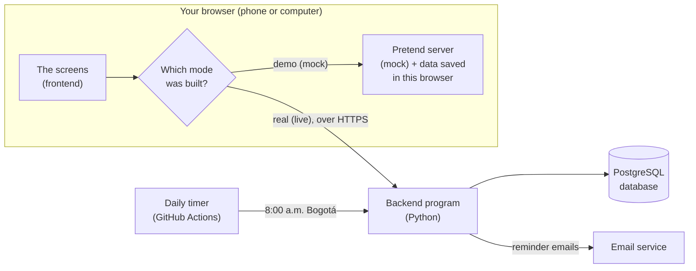
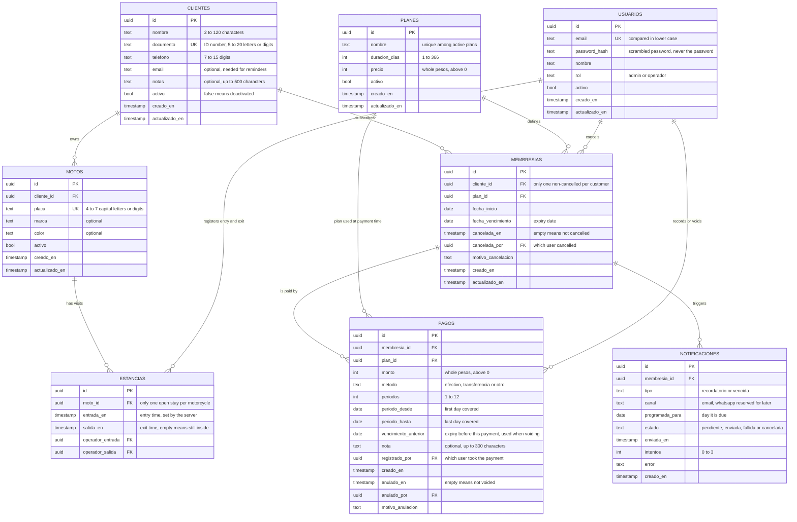
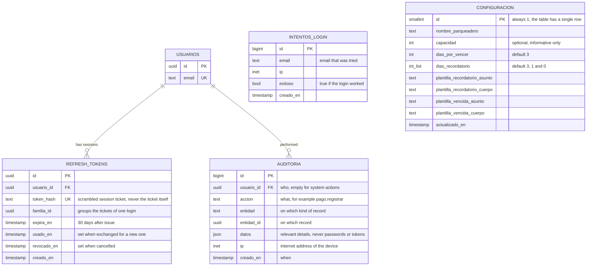

# The motorcycle parking app, explained in plain language

> A guide for someone who is **not** a software engineer. It explains what the app does, how to use it, how its data is organised, where everything runs, and how safe it is.
>
> Written on 2026-11-11 from the code on the `main` branch (commit `eaa909c`). The app's screens are in Spanish, so this guide quotes the Spanish labels you will see and translates them.

**How to read the confidence marks**

| Mark | Meaning |
|---|---|
| ✅ | I checked this directly in the code or configuration files of this repository. |
| ⚠️ **Unverified** | The repository says or implies it, but it depends on something outside the repository (an account on another company's website, a setting I cannot see, a live server). Treat it as "expected", not "confirmed". |
| 🚧 | Designed and documented, but **not built yet**. |

---

## Contents

1. [The app in one page](#1-the-app-in-one-page)
2. [Words you need to know](#2-words-you-need-to-know)
3. [The two modes: demo and real](#3-the-two-modes-demo-and-real)
4. [What is built today and what is not](#4-what-is-built-today-and-what-is-not)
5. [Full list of functions](#5-full-list-of-functions)
6. [The business rules, with examples](#6-the-business-rules-with-examples)
7. [How the data is organised (diagrams)](#7-how-the-data-is-organised-diagrams)
8. [Tutorial: using the app step by step](#8-tutorial-using-the-app-step-by-step)
9. [Where everything runs and is stored](#9-where-everything-runs-and-is-stored)
10. [The database: where it is and how you can open it](#10-the-database-where-it-is-and-how-you-can-open-it)
11. [Safety: what is protected and what is not](#11-safety-what-is-protected-and-what-is-not)
12. [If you wanted to launch tomorrow](#12-if-you-wanted-to-launch-tomorrow)
13. [Where to look in the repository](#13-where-to-look-in-the-repository)

---

## 1. The app in one page

This is a website for the staff of a motorcycle parking lot. Customers never use it; only the people who work there do. With it, staff can:

- keep a list of **customers** and their **motorcycles**;
- sell **memberships** (for example "monthly, 30 days, $60.000 COP") and record every **payment**;
- record each time a motorcycle **enters** and **leaves**, by typing its licence plate;
- see at a glance how many motorcycles are inside, which memberships are about to expire, and how much money came in today;
- (once email is set up) automatically **email customers** a reminder before their membership expires.

It is a **web app**: you open it in a browser (Chrome, Safari) on a phone or computer by visiting an address. There is nothing to install. It was designed for a phone screen first, because the person at the gate will usually hold a phone.

The app exists in **two modes** that look identical:

- **Demo mode**: a showroom copy with made-up customers. Nothing is sent anywhere; the data lives inside the visitor's own browser. This is what is published on the internet today.
- **Real mode** (the code calls it "live"): the same screens, but connected to a real server and a real database, so that all staff share the same data. The code for this is largely written, but **it has not been put on the internet yet** (see [section 9](#9-where-everything-runs-and-is-stored)).

The short honest summary: **the demo works and is public; the real system is roughly four fifths built and not deployed.** Section 4 says exactly what is missing.

---

## 2. Words you need to know

Software words, defined once:

| Word | Plain meaning |
|---|---|
| **Frontend** | The part you see and touch: the screens, buttons and forms. It runs inside your browser. |
| **Backend** | A program running on a computer in a data centre (a "server"). It receives requests from the frontend, checks the rules, and reads or writes the database. Here it is written in the Python language. |
| **API** | The list of requests the frontend is allowed to send to the backend, such as "log me in" or "record a payment". Think of it as the counter window between the two. |
| **Database** | An organised store of information made of **tables**. A table is like a spreadsheet sheet: columns are fixed (name, phone…) and each row is one item (one customer). |
| **SQL / PostgreSQL** | SQL is the standard language for asking questions of a database. PostgreSQL (often "Postgres") is the specific database program this project uses. |
| **Hosting** | Renting a computer on the internet to keep your program or files available all day. |
| **Deploy** | To put a new version of the program on that rented computer. |
| **Repository ("repo")** | The folder holding all the project's code and documents, stored on the website GitHub with full history of every change. |
| **Mock** | A stand-in that imitates the real backend. Demo mode uses a mock: a piece of code inside the browser that pretends to be the server. |
| **Token** | A long random text the server gives your browser after you log in. Your browser shows it with every request to prove who you are, like a wristband at an event. |
| **Hash** | A one-way scramble. A password is turned into a hash before being stored; the hash can be used to check a password but cannot be turned back into the password. |
| **Encryption / HTTPS / TLS** | Scrambling data while it travels over the internet so nobody in between can read it. HTTPS is the padlock in your browser's address bar; TLS is the technology behind it. |
| **Secret** | A password-like value that the server needs (for example, the database password). Secrets are never written in the repository. |
| **Environment variable** | A setting given to a program from outside when it starts, used for secrets and for things that differ between test and real use. |
| **Migration** | A small script that creates or changes the database tables. Each change to the database structure is a new numbered migration, so the structure has a history. |

Business words (the app uses the Spanish terms):

| App term (Spanish) | Meaning |
|---|---|
| **Usuario** (user) | A staff member who logs in. Has a role: `admin` or `operador`. |
| **Admin** | The owner or manager. Can do everything. |
| **Operador** (operator) | Day-to-day staff. Can register entries, exits, customers and payments, but cannot cancel, void, deactivate or configure. |
| **Cliente** (customer) | Owner of one or more motorcycles. Does **not** log in. |
| **Moto** | A motorcycle, identified by its **placa** (licence plate). Belongs to exactly one customer. |
| **Plan** | A product for sale: a name, a number of days and a price. Example: "Mensual · 30 días · $60.000". |
| **Membresía** (membership) | A customer's current subscription to a plan. **One membership covers all of that customer's motorcycles.** |
| **Pago** (payment) | A record of money received for a membership. |
| **Estancia** (stay) | One visit of a motorcycle: an entry time and, once it leaves, an exit time. A stay with no exit means the motorcycle is **inside**. |
| **Notificación** | A reminder email to a customer about their expiry date. |
| **Auditoría** (audit log) | A permanent diary of who did what and when. |

---

## 3. The two modes: demo and real

The same screens can be plugged into two different "data sources". A single setting chosen when the website is built (`VITE_API_MODE`, value `mock` or `live`) decides which. ✅



| | Demo mode (`mock`) | Real mode (`live`) |
|---|---|---|
| Purpose | Show the app to anyone, safely | Run the actual business |
| Where the data lives | Inside the visitor's own browser, on their own device ✅ | In one shared PostgreSQL database on the internet ✅ (design) |
| Who sees my changes | Only me, only in this browser. Another phone sees its own separate copy. ✅ | Every staff member, immediately |
| Starting data | 12 invented customers, 3 plans, about 35 stays, payments and sample reminders, with dates calculated relative to the day the demo was first opened so every status is always represented ✅ | Empty. You create everything. |
| Login | Public test accounts shown on the login screen ✅ | Real accounts with private passwords |
| A blue banner at the top | Yes: "Modo demo: los datos son ficticios y se guardan solo en este navegador." with a "Reiniciar datos" (reset data) button ✅ | No banner |
| Emails | Never sent ✅ | Sent by the daily job once an email service is configured |
| Needs a server | No | Yes (backend + database) |
| Safe for real customer data | **No** | Yes, that is its purpose |

Two things about demo mode that surprise people:

- **Your demo changes survive closing the browser**, because they are saved in the browser's permanent storage (called `localStorage`). They disappear if you press "Reiniciar datos", clear your browsing data, or use a private/incognito window. ✅
- **You are logged out when you close the tab**, because the login "wristband" is kept in a storage area that the browser empties when the tab closes (`sessionStorage`). This is true in both modes. ✅

The demo imitates the real server's rules closely (same validations, same error messages, same permissions, even a short artificial delay of 0.15 to 0.4 seconds so it feels like a real network). ✅ The real version of the app that gets built in live mode **does not contain** the demo data or the demo passwords at all; an automatic check refuses to publish it if it does. ✅

---

## 4. What is built today and what is not

This matters more than anything else in this guide, so it comes early. The project plan lists nine screens (P1 to P9) and a set of server functions. Here is the real state of the code. ✅ (all rows verified by reading the code)

### Screens (frontend)

| # | Screen | Menu name | State |
|---|---|---|---|
| P1 | Login | — | Built |
| P2 | Dashboard (home summary) | Inicio | Built |
| P3 | Register entry / exit | Acceso | Built |
| P4 | Customer list and customer file | Clientes | Built |
| P5 | New customer | Clientes → Nuevo | Built |
| P6 | Memberships (list, create, change plan, cancel) | Membresías | Built |
| P7 | Payments (list, register, void) | Pagos | Built |
| — | Change my own password | Menu → Cambiar contraseña | Built |
| P8 | Access history with filters and spreadsheet export | Historial | 🚧 **Not built.** The menu item opens a page that only says "Página provisional". |
| P9 | Settings: plans, staff users, reminder days, email wording, list of sent reminders | Configuración | 🚧 **Not built.** Same placeholder page. |

### Server functions (backend)

| Area | State |
|---|---|
| Login, session renewal, logout, change password | Built |
| Entries, exits, "who is inside", history list | Built |
| Customers and motorcycles | Built |
| Plans (list, create, edit, deactivate) | Built |
| Memberships and payments, including voiding | Built |
| Daily reminder job and email sending | Built |
| List of reminders (admin) | Built |
| **Dashboard summary numbers** | 🚧 **Not built** |
| **Staff user management** (create an operator, deactivate a user) | 🚧 **Not built** |
| **Settings** (parking name, capacity, reminder days, email wording) | 🚧 **Not built** (the settings are stored in the database with default values, but there is no way to change them through the app) |
| **Export history to a spreadsheet file (CSV)** | 🚧 **Not built** |

### What that means in practice

- **In demo mode**, everything in the "Built" screens works end to end, including the dashboard, because the pretend server implements every function. The pretend server even implements users, settings and export, but there is no screen to reach them.
- **In real mode, as the code stands today:**
  - The **dashboard (home) screen would show an error** instead of numbers, because it asks the server for a summary that the server cannot yet provide. (I concluded this from reading both sides of the code; I did not run a live server to watch it happen. ⚠️)
  - There is **no way to create operator accounts** from the app. The only way to create a user is a command that creates an **admin**. So everyone would have to be an admin, or share one account.
  - There is **no screen to create plans**. A brand-new real database contains **no plans**, and without a plan you cannot create a membership. Plans can be created by sending the request to the server by hand (a technical task), since the server side exists.
  - The parking lot's name, capacity, "about to expire" threshold, reminder days and email wording stay at their defaults unless someone edits the database directly.
- Also not done from the project plan: automated end-to-end tests against a real server (item C-02), the final accessibility review of the demo (A-10), and the owner's final acceptance (C-04).

> Note: the status column in `docs/ROADMAP.md` is partly out of date (for example it shows most demo screens as "in review" although they are merged). The tables above reflect the code, not that column.

---

## 5. Full list of functions

Legend for "Who": **Both** = admin and operator; **Admin** = admin only. "Works today" refers to what you can actually do through the screens.

### Accounts and sessions

| Function | Who | Demo | Real mode |
|---|---|---|---|
| Log in with email and password | Both | ✅ | ✅ built |
| Stay logged in while the tab is open, even after reloading the page | Both | ✅ | ✅ built |
| Automatic return to the login screen when the session expires, then back to where you were | Both | ✅ | ✅ built |
| Log out | Both | ✅ | ✅ built |
| Change my own password (logs you out afterwards) | Both | ✅ | ✅ built |
| Lock-out after too many wrong passwords | — | ✅ imitated | ✅ built |
| "Forgot my password" recovery by email | — | 🚧 planned for a later phase | 🚧 |
| Create, edit, deactivate staff users | Admin | 🚧 no screen | 🚧 no screen, no server function |

### Entries and exits

| Function | Who | Demo | Real mode |
|---|---|---|---|
| Look up a licence plate and see owner, motorcycle, membership status, and whether it is inside | Both | ✅ | ✅ built |
| Register an entry (with warnings if the membership is expired, about to expire, or missing) | Both | ✅ | ✅ built |
| Register an exit (shows how long it stayed) | Both | ✅ | ✅ built |
| List of motorcycles inside right now, with filter by plate and a "more than 24 h" flag | Both | ✅ | ✅ built |
| Offer to register a new customer when the plate is unknown | Both | ✅ | ✅ built |
| A customer's own access history (tab "Accesos" in the customer file) | Admin | ✅ | ✅ built |
| Full history screen with date, plate and operator filters | Admin | 🚧 no screen | 🚧 no screen (server function exists) |
| Export history to a spreadsheet file | Admin | 🚧 no screen | 🚧 |

### Customers and motorcycles

| Function | Who | Demo | Real mode |
|---|---|---|---|
| List customers; search by name, document or plate; filter by membership status | Both | ✅ | ✅ built |
| Create a customer with up to 5 motorcycles in one form | Both | ✅ | ✅ built |
| Open a customer file: contact data, membership, motorcycles, payments | Both | ✅ | ✅ built |
| Edit a customer; add or edit a motorcycle | Both | ✅ | ✅ built |
| Deactivate / reactivate a customer or a motorcycle; show inactive ones | Admin | ✅ | ✅ built |
| Delete a customer | — | Not possible by design: records are deactivated, never deleted | Same |

### Plans, memberships and payments

| Function | Who | Demo | Real mode |
|---|---|---|---|
| Choose among the active plans when creating a membership | Both | ✅ | ✅ built |
| Create, edit, deactivate plans | Admin | 🚧 no screen | 🚧 no screen (server function exists) |
| List memberships; search; filter by status; most urgent first | Both | ✅ | ✅ built |
| Create a membership together with its first payment | Both | ✅ | ✅ built |
| Change a membership's plan | Both | ✅ | ✅ built |
| Cancel a membership (requires a reason; final) | Admin | ✅ | ✅ built |
| Register a payment for 1 to 12 periods, with a live preview of the new expiry date | Both | ✅ | ✅ built |
| List payments by date range and payment method | Both | ✅ | ✅ built |
| Void a payment (requires a reason; only the most recent one) | Admin | ✅ | ✅ built |

### Overview and reminders

| Function | Who | Demo | Real mode |
|---|---|---|---|
| Dashboard: inside now / capacity, about to expire, expired, today's payments, long stays, next expiries, today's entries and exits | Both | ✅ | 🚧 screen exists, server function missing |
| Daily reminder emails 3 days before, 1 day before, on the day, and one "overdue" notice the day after | automatic | Never sent | ✅ built, needs an email service configured |
| List of reminders sent | Admin | 🚧 no screen | 🚧 no screen (server function exists) |
| Edit reminder days and email wording | Admin | 🚧 no screen | 🚧 |

### Behind the scenes (real mode only)

| Function | State |
|---|---|
| Audit log: every change, every login and every failed login is recorded with who, what, when and from which internet address | ✅ built. There is no screen to read it; it is read in the database. |
| Automatic database structure updates each time a new version is deployed | ✅ built |
| Automatic checks on every code change: tests, style, known security holes in third-party components, accidental secrets | ✅ built |

---

## 6. The business rules, with examples

These rules are enforced by the server (and imitated by the demo). The codes in brackets (RN-xx) are the rule numbers in `docs/dominio.md`, the project's rule book.

### Licence plates (RN-01)

Whatever you type is tidied up first: capital letters, no spaces, no dashes. `abc-12d` and `ABC 12D` both become `ABC12D`. A plate must be 4 to 7 letters or digits and can belong to only one motorcycle.

### Money and dates (RN-02, RN-03)

Amounts are whole Colombian pesos with no cents, shown as `$60.000`. "Today" always means today in Bogotá, wherever the server physically is.

### Membership status is calculated, never typed in (RN-32)

Nobody sets a membership's status by hand. The app works it out each time from two stored facts: the expiry date, and whether it was cancelled.

| Situation | Status shown |
|---|---|
| It was cancelled | **Cancelada** |
| Today is after the expiry date | **Vencida** (expired) |
| Expiry is today or within the next 3 days (3 is the default threshold) | **Por vencer** (about to expire) |
| Otherwise | **Activa** |

On the expiry date itself the membership still counts (status "por vencer"); it becomes expired the next morning.

### One membership per customer, born with a payment (RN-30, RN-31)

A customer can have at most one membership that is not cancelled, and it covers all their motorcycles. You cannot create a membership without recording its first payment in the same step. Expiry date = start date + plan days − 1. Example: a 30-day plan starting 10 November expires 9 December.

### How a payment extends the expiry date (RN-41, RN-42)

- **If the membership has not expired:** the new period starts the day after the current expiry. The customer loses nothing by paying early.
  *Example:* today is the 10th, expiry is the 12th, plan is 30 days. The payment covers from the 13th for 30 days. The 2 remaining days are kept.
- **If the membership has already expired:** the new period starts **today**. The days in arrears are neither charged nor given away.
  *Example:* it expired 10 days ago; paying today for 30 days gives 30 days from today.
- Paying for several periods multiplies the days: 3 periods of a 30-day plan = 90 days.

Before you confirm, the screen shows exactly which dates the payment covers and what the new expiry will be.

### The amount (RN-43)

The app suggests plan price × number of periods. Staff may type a different amount (a discount, an arrangement), but then a **note explaining why becomes mandatory**.

### Payments are never edited or deleted (RN-45, RN-46)

A wrong payment is **voided** (anulado) by an admin, with a written reason. Only the **most recent** payment of a membership can be voided, and voiding puts the expiry date back to what it was before. The voided payment stays visible, struck through, and does not count in totals. If the membership's only payment is the wrong one, you cancel the membership instead.

### Entry is never blocked by an expired membership (RN-52)

This was a deliberate decision by the owner: the gate should not be held up. If the membership is expired, about to expire, or missing, the app shows a **warning** and the button changes to "Registrar entrada de todos modos" (register entry anyway). The staff member decides. Exits are never blocked.

### A motorcycle can only be inside once (RN-50)

You cannot register an entry for a motorcycle that is already inside. This is guaranteed by the database itself, so even if two staff press the button at the same instant only one entry is recorded.

### Unknown plates (RN-51)

The app does not handle casual visitors paying by the hour. A plate must belong to a registered customer; if it is unknown, the app offers to register the customer on the spot, with the plate already filled in.

### Mistakes are corrected, not erased (RN-56, D-12)

An entry registered by mistake is fixed by registering the exit. Customers, motorcycles and plans are **deactivated**, not deleted, so history is never lost. A customer or motorcycle that is currently inside cannot be deactivated.

### Reminder emails (RN-60 to RN-64)

Once a day, for each non-cancelled membership whose customer has an email address, the server sends a reminder 3 days before, 1 day before, and on the expiry date, plus one "overdue" notice the day after. Running the job twice in a day does not send duplicates. If the job does not run on a given day, **that day's emails are not sent late**. A failed email is retried up to 3 times, the same day only. A customer without an email receives nothing, and their file shows the warning "Sin email: no recibirá avisos de vencimiento."

### Who may do what

| Action | Operator | Admin |
|---|:-:|:-:|
| Log in, change own password | ✅ | ✅ |
| See the dashboard | ✅ | ✅ |
| Look up a plate, register entry and exit, see who is inside | ✅ | ✅ |
| See, create and edit customers and motorcycles | ✅ | ✅ |
| Deactivate or reactivate customers and motorcycles | ❌ | ✅ |
| See plans | ✅ | ✅ |
| Create, edit, deactivate plans | ❌ | ✅ |
| See memberships, create one, change its plan | ✅ | ✅ |
| Cancel a membership | ❌ | ✅ |
| See payments, register a payment | ✅ | ✅ |
| Void a payment | ❌ | ✅ |
| See access history | ❌ | ✅ |
| See reminders, manage users, change settings | ❌ | ✅ |

The server checks the role on every single request, reading it fresh from the database, so hiding a button is never the only protection. ✅

---

## 7. How the data is organised (diagrams)

The real database has **12 tables**, all created by one migration script (`backend/alembic/versions/0001_esquema_inicial.py`). ✅

How to read the diagrams: each box is a table and lists its columns. A line between two boxes means "rows in one refer to rows in the other". The symbols on a line read as "one" (`||`) and "zero or many" (`o{`). So `CLIENTES ||--o{ MOTOS` reads: *one customer has zero or many motorcycles; each motorcycle has exactly one customer.* **PK** marks the column that uniquely identifies a row; **FK** marks a column that points at a row in another table; **UK** marks a value that cannot repeat.

### 7.1 The business tables



Things worth noticing:

- **There is no "status" column on memberships.** Status is calculated from `fecha_vencimiento` and `cancelada_en` each time (see section 6), so it can never be stale.
- **There is no "is inside" column on motorcycles.** A motorcycle is inside when it has a stay with an empty `salida_en`.
- **A payment remembers its own amount and plan.** Changing a plan's price later does not rewrite history.
- **Nothing here can be deleted through the app**, and the database refuses to delete a row that other rows still point to.
- Customers and staff users are completely separate tables: a customer can never log in.

### 7.2 The security and system tables



- **`auditoria`** is the diary. The database itself blocks any attempt to change or delete a diary row (a built-in guard called a trigger). ✅
- **`refresh_tokens`** keeps track of who is logged in, so sessions can be cancelled.
- **`intentos_login`** records login attempts, which is how the lock-out after repeated wrong passwords works. It stands alone (no lines to other tables) because a failed attempt may use an email that does not exist.
- **`configuracion`** always has exactly one row holding the settings.

### 7.3 Demo mode storage

Demo mode has no database. The pretend server keeps one single block of text in the browser, under the name `parqueadero.demo.v1`, containing lists with the same shapes as the business tables above: users, customers, motorcycles, plans, memberships, payments, stays, notifications and settings. ✅ It has **no audit log**, and it stores the two demo users' passwords as plain readable text, which is acceptable only because they are public test passwords. ✅

---

## 8. Tutorial: using the app step by step

You can follow every step below right now in the demo. Menu names are given in Spanish as they appear. On a phone the menu is a bar at the bottom of the screen (Inicio, Clientes, **Acceso** as a big round button in the middle, Membresías, and "Más" for the rest). On a computer it is a dark column on the left.

### 8.0 Opening the demo and logging in

1. Open the demo address in a browser. From the configuration it should be `https://shaktiintelligence777-sudo.github.io/PROYECTO-PARQUEADERO/` (⚠️ I could not open it from where I work; see section 9 about the current publishing problem).
2. You see a blue strip at the top saying it is demo mode, and the login card.
3. Under the login button there is a box "Usuario de prueba" with a button **"Usar estos datos"** (use these details). Press it; it fills the email `demo@parqueadero.app` and the password `demo1234`. Then press **"Iniciar sesión"**.
4. That account is an **admin** and lands on the dashboard ("Inicio").
5. To see the app as an operator, log out and type `operador@parqueadero.app` with the same password `demo1234`. An operator lands directly on the "Acceso" screen and does not see the admin-only items.

What can go wrong at login:

| Message | Meaning |
|---|---|
| "Email o contraseña incorrectos." | Wrong email or password. The message is deliberately the same in both cases. |
| "Demasiados intentos. Espera unos minutos e inténtalo de nuevo." | Five wrong passwords for the same email within 15 minutes. Wait 15 minutes. |
| "Tu sesión venció. Inicia sesión otra vez." | Your session ended; log in again and you return to where you were. |

### 8.1 The dashboard ("Inicio")

This is the summary. It refreshes by itself every 60 seconds.

- Four tiles, each of which you can tap to go to the matching list:
  - **"Dentro ahora"**: motorcycles inside right now, shown against capacity (for example `5 / 40`).
  - **"Por vencer"**: memberships about to expire.
  - **"Vencidas"**: memberships already expired.
  - **"Pagos de hoy"**: total money recorded today and the number of payments.
- A warning line if any motorcycle has been inside more than 24 hours (often a forgotten exit).
- **"Próximos vencimientos"**: the next few memberships to expire. Tap one to open that customer.
- **"Movimiento de hoy"**: count of today's entries and exits.

### 8.2 Registering an entry ("Acceso")

This is the most used screen. It has two tabs: **"Registrar"** and **"Dentro (N)"**.

1. Go to **Acceso**. The cursor is already in the "Placa" box.
2. Type the plate, for example `ABC12D`, and press **"Buscar"** (or Enter). You can type lower case or with a dash; it is tidied up.
3. A card appears with the plate, make and colour, the owner's name, and a coloured label with the membership status.
4. Press the big button:
   - **"Registrar entrada"** if all is well.
   - **"Registrar entrada de todos modos"** if there is a red warning (expired or no membership). The warning includes a shortcut link to register the payment or create the membership.
5. A confirmation appears briefly ("Entrada registrada · ABC12D"), the box empties, and you are ready for the next motorcycle.

Demo plates to try, and what each demonstrates:

| Plate | What you will see |
|---|---|
| `XYZ34E` | A customer in good standing who is outside: a plain entry. |
| `ABC12D` | Already inside: the button offers the exit instead. |
| `PQR33L` | Membership expires today: an amber "vence pronto" warning. |
| `VWX55P` | Expired membership: red warning, "register entry anyway". This customer also has no email. |
| `BCD77R` | Customer with no membership at all. |
| `YZA66Q` | Customer whose membership was cancelled (treated as no membership). |
| `ZZZ999` | Unknown plate: the app offers "Registrar cliente nuevo". |

### 8.3 Registering an exit

Either:

- **By plate:** in the "Registrar" tab, search the plate. Because the motorcycle is inside, the card says since when (for example "Dentro desde las 8:15 a. m. (2 h 15 min)") and the button is **"Registrar salida"**. Press it.
- **From the list:** open the tab **"Dentro (N)"**, find the motorcycle (there is a "Filtrar por placa" box), press **"Salida"** and confirm.

The list of motorcycles inside refreshes by itself every 30 seconds, and motorcycles inside for more than a day carry a "Más de 24 h" label.

### 8.4 Registering a new customer ("Clientes" → "Nuevo")

1. Go to **Clientes** and press **"+ Nuevo"** (or arrive here from an unknown plate, in which case the plate is already filled in).
2. Fill in:
   - **Nombre completo** (required)
   - **Documento**: ID number, 5 to 20 letters or digits (required, cannot repeat)
   - **Teléfono**: 7 to 15 digits (required)
   - **Email** (optional, but without it the customer gets no reminders)
   - **Notas** (optional)
3. Under **"Moto"**, type the **Placa** (required for each motorcycle listed) and optionally Marca (make) and Color. Use **"+ Agregar otra moto"** for up to 5. You may remove the row to create a customer with no motorcycle.
4. Press **"Guardar cliente"**.
5. The customer's file opens with the **"Crear membresía"** form already open, so you can sell the membership straight away.

Possible messages: "Ya existe un cliente con ese documento." (that ID number is already registered) and "Esa placa ya está registrada." (that plate belongs to another motorcycle).

### 8.5 Finding a customer and reading their file

1. Go to **Clientes**. Type in the search box: part of the name, the document number, or a plate.
2. Optionally narrow with the status buttons: Todos, Activa, Por vencer, Vencida, Sin membresía.
3. Tap a customer to open the file. It shows:
   - contact details (the phone number is tappable to call);
   - the **membership** card: plan, price, status, expiry date, and the buttons **"Registrar pago"**, **"Cambiar plan"** and, for admins, **"Cancelar membresía"**;
   - the list of **motorcycles**, with a "Dentro" label if one is inside, a pencil to edit, and **"+ Moto"** to add another;
   - the tab **"Pagos"** (payment history) and, for admins, the tab **"Accesos"** (that customer's entries and exits).
4. **"Editar"** opens the contact details for changes. Admins also see **"Desactivar cliente"** there.

### 8.6 Creating a membership

A membership is always created from the customer's file, and always with its first payment.

1. Open the customer's file. If they have none, the card says "Este cliente no tiene membresía." Press **"Crear membresía"**.
2. Choose the **Plan** (for example "Mensual · 30 días · $60.000").
3. **Fecha de inicio** is today by default. It can be up to 31 days in the past or future.
4. **Monto** fills in with the plan's price. If you change it, the **Nota** becomes mandatory.
5. Choose the **Método de pago**: Efectivo (cash), Transferencia (bank transfer) or Otro (other).
6. Read the line "Cubre del … al …" (covers from … to …), which is calculated live.
7. Press **"Crear y registrar pago"**. You see "Membresía creada. Vence el …".

### 8.7 Registering a renewal payment

There are three ways to start, all ending at the same form:

- **Membresías** → find the customer → **"Renovar"**;
- the customer's file → **"Registrar pago"**;
- **Pagos** → **"Registrar pago"**, then search the customer by name, document or plate.

Then:

1. Check the customer card at the top.
2. Set **Periodos** with the − and + buttons (1 to 12). The amount updates.
3. Adjust **Monto** only if the customer is paying something different; a note then becomes mandatory.
4. Choose the payment method (cash is the default).
5. Read the **"Resumen"** box: which dates are covered, the current expiry and the **new expiry**. If the membership is expired, a note explains that the new period starts today.
6. Press the button, which reads **"Registrar $60.000"** (with your amount).
7. A confirmation screen shows the amount, method, customer and new expiry, with "Registrar otro pago" and "Ver cliente".

### 8.8 Reviewing payments ("Pagos")

1. Go to **Pagos** (on a phone: "Más" → Pagos). It opens on today's payments.
2. Use the quick ranges "Hoy", "Últimos 7 días", "Este mes" or "Personalizado" (pick two dates), and the method selector.
3. Each line shows date and time, customer, amount, method and who recorded it. Voided payments are struck through and labelled "Anulado".
4. Tap a payment to open its detail.

### 8.9 Voiding a wrong payment (admin)

1. In **Pagos**, tap the payment to open its detail.
2. Press **"Anular pago"**.
3. The app tells you what the expiry date will go back to and asks for a **reason**. Confirm.
4. If you see "Solo se puede anular el último pago de una membresía.", that payment is not the most recent one for that membership and cannot be voided.

### 8.10 Changing a plan

1. Customer file → **"Cambiar plan"**.
2. Pick the new plan and confirm. The current expiry date does **not** change; the new plan's length and price apply from the next payment.

### 8.11 Cancelling a membership (admin)

1. Customer file → **"Cancelar membresía"**.
2. Type the reason and confirm. This is **final**. It does not refund or void anything. If the customer returns, you create a new membership.

### 8.12 Deactivating a customer or motorcycle (admin)

- Customer: file → **"Editar"** → **"Desactivar cliente"**. Their motorcycles are deactivated too. They stop appearing in searches and cannot enter, but all history is kept. Not allowed while one of their motorcycles is inside.
- Motorcycle: pencil next to it → **"Desactivar moto"**. Not allowed while it is inside.
- To see deactivated customers again, tick **"Mostrar inactivos"** on the customer list; from there you can open one and **"Reactivar"**.

### 8.13 Changing your password and logging out

- **Cambiar contraseña** (in the left column on a computer; under "Más" on a phone): type the current password and the new one twice (at least 8 characters). You are logged out and asked to log in with the new one.
- **Cerrar sesión** logs you out. Closing the tab also ends the session.

### 8.14 Resetting the demo

Press **"Reiniciar datos"** in the blue strip and confirm. Your demo changes are erased and the original invented data is rebuilt with today's date as the reference. You stay logged in.

### 8.15 Things you will look for and not find

- **Historial** and **Configuración** open a page that says "Página provisional". They are not built (section 4).
- There is no screen to add staff, add plans, or change the reminder texts.
- There is no "forgot my password" link.
- The app can be added to a phone's home screen like an app icon, but it does **not** work without an internet connection in real mode (there is no offline storage). ✅

---

## 9. Where everything runs and is stored

### 9.1 The direct answers

| Question | Answer |
|---|---|
| **GitHub Pages?** | **Yes.** The screens (frontend) are published on GitHub Pages, a free service from GitHub that serves website files. ✅ This is the only piece that is actually on the internet today. |
| **Cloudflare?** | **No.** Nothing in this project uses Cloudflare. There is no Cloudflare configuration anywhere in the repository. ✅ |
| **Render?** | **Planned, yes.** Render is the company chosen to run the backend program. The configuration file is ready (`render.yaml`). ⚠️ Whether a Render account and service actually exist cannot be seen from the repository; the security report dated 2026-11-11 states the accounts did not exist yet. |
| **Neon?** | **Planned, yes.** Neon is the company chosen to host the PostgreSQL database. There are step-by-step instructions (`docs/operacion.md`). ⚠️ Same caveat: not verifiable from here, and reported as not yet created. |
| **Supabase, Railway, others?** | **No.** They are mentioned in the plan only as alternatives that were considered. The owner's decision (labelled D-1, confirmed 2026-11-10) is Render + Neon. ✅ |
| **An email service?** | **Not chosen or configured yet.** The code can send through a service called Resend or through any standard mail server (SMTP). Until one is configured, the default setting only writes a line in the server's log and **sends nothing**. ✅ |

### 9.2 The full map

| Piece | What it is | Where it lives | State today |
|---|---|---|---|
| Source code and documents | All the project files and their history | GitHub, repository `shaktiintelligence777-sudo/PROYECTO-PARQUEADERO`. The repository is **public**: anyone on the internet can read the code. ✅ | Live |
| The screens (frontend) | Plain website files | **GitHub Pages**, on GitHub's servers ✅ | Live, in **demo mode** |
| Demo data | Invented customers etc. | Inside each visitor's **own browser** ✅ | Live |
| The backend program | Python program in a container | **Render**, free plan, region "Virginia" (USA) ✅ per configuration | ⚠️ Not deployed as far as the repository shows |
| The database | PostgreSQL version 16 | **Neon**, free plan, region "AWS US East 1 (N. Virginia)" ✅ per instructions | ⚠️ Not created as far as the repository shows |
| The daily reminder timer | A scheduled task that knocks on the backend's door every day at 13:00 UTC = 8:00 a.m. Bogotá | **GitHub Actions** (GitHub's built-in automation) ✅ | Scheduled, but **failing**: it ran once (2026-11-11) and failed. The most likely reason is that there is no backend to call and its two required settings are not filled in. ⚠️ I did not read the failure log. |
| Email sending | Outgoing reminder emails | Resend or an SMTP mail server | Not configured |
| Automatic quality and security checks | Tests and scans on every change | GitHub Actions ✅ | Live |
| Secrets | Database password, signing key, service key | Typed by you into Render's settings page and GitHub's "Secrets" page; **never** in the repository ✅ | Not created yet ⚠️ |

"Container" means a sealed package containing the program and everything it needs, so it runs the same way anywhere.

### 9.3 How a new version gets published

- **Frontend:** whenever a change to the frontend is merged into the main branch, GitHub Actions automatically runs the tests, builds the website files and publishes them to GitHub Pages. ✅ Which mode it builds is decided by two settings in the repository (Settings → Secrets and variables → Actions → Variables): `API_MODE` and `API_URL`. If they are not set, it builds the **demo**. ✅
- **Backend:** Render is configured to rebuild and restart the backend automatically whenever the main branch changes. On every start it first applies any pending database migrations and only then accepts traffic; if a migration fails, the previous version keeps running. ✅ (configuration) ⚠️ (never exercised on a real Render service, as far as the repository shows)

### 9.4 A publishing problem you should know about ✅

The last **two** automatic publications of the demo **failed** (both on 2026-11-11, after the "live adapter" work was merged). The site still shows the last successful publication, from 2026-11-11 at about 01:04 UTC, which includes all the built screens.

Cause, confirmed by reproducing it: the publication has a safety check that refuses to publish a demo containing the name of the backend-address setting. Since the latest changes, the build step passes that setting with an empty value, which makes its name appear inside the built files, so the check trips. Nothing is wrong with the app itself. Until this is fixed, **further changes to the demo will not reach the public site**. Switching the site to real mode would bypass this particular check, because it only applies to demo builds.

### 9.5 Limits of the free plans

- **Render free plan:** the backend "falls asleep" after about 15 minutes with no visitors. The first request afterwards takes 30 to 60 seconds while it wakes up; after that it is normal. For a parking lot used all day, the smallest paid plan avoids the morning wait. (Stated in `docs/operacion.md`. ⚠️ Check Render's current plan terms.)
- **Neon free plan:** limited storage and a short history window for undoing mistakes (the project's operations document says 24 hours). ⚠️ Check Neon's current plan terms; these limits change.
- **GitHub Pages:** one website per repository. So **the demo and the real app cannot both live at the same address**: switching the repository to real mode replaces the demo. Keeping both would need a second repository or a separate address.
- **GitHub's scheduled timer** is not exact; it can run several minutes late. ⚠️ (General GitHub behaviour, not something in this repository.)

---

## 10. The database: where it is and how you can open it

### 10.1 Where it physically is

- **Demo mode:** there is no database. The data is a block of text in the browser of whoever is using the demo.
- **Real mode:** a PostgreSQL 16 database hosted by **Neon**, on Neon's servers in the United States (N. Virginia), in an account that **you** create and own. ✅ per the instructions. The backend on Render connects to it over an encrypted connection using a secret address called `DATABASE_URL`.
- **On a developer's computer:** a throwaway PostgreSQL started with a tool called Docker, with invented data, used only for building and testing. ✅

### 10.2 Can you access the real database directly? Yes

It will be your Neon account, so you have full access. Three ways, from easiest to most technical:

1. **Neon's website.** Log in at `console.neon.tech`, open the project, and use the **Tables** view to browse rows like a spreadsheet, or the **SQL Editor** to type questions. No installation. ⚠️ (Neon's features, not part of this repository.)
2. **A desktop database program** such as DBeaver, TablePlus or pgAdmin. You paste the connection address from Neon ("Connect" button) and browse the tables with a graphical interface.
3. **The command line**, with the standard `psql` tool and the same connection address.

Example questions you could ask in the SQL Editor:

```sql
-- How many customers are registered?
select count(*) from clientes;

-- Money recorded per day, ignoring voided payments
select date(creado_en) as dia, sum(monto) as total
from pagos
where anulado_en is null
group by 1 order by 1 desc;

-- Motorcycles inside right now
select m.placa, c.nombre, e.entrada_en
from estancias e
join motos m on m.id = e.moto_id
join clientes c on c.id = m.cliente_id
where e.salida_en is null;

-- The last 50 things anyone did
select creado_en, accion, entidad, datos from auditoria order by id desc limit 50;
```

### 10.3 Three warnings about direct access

1. **Look, do not touch.** Reading is safe. **Changing** rows by hand skips all of the app's rules and leaves **no entry in the audit log**. A hand-edited expiry date or payment is exactly the kind of untraceable change the app was designed to prevent. If you must fix data by hand, write down what and why.
2. **The connection address is the master key.** Anyone who has `DATABASE_URL` can read and change everything. Keep it in a password manager. Never paste it in a chat, an email, or the repository. If it leaks, reset the database password in Neon and update it in Render (the steps are in `docs/operacion.md`, section 8).
3. **You cannot read passwords there.** The `usuarios` table stores only scrambled hashes. Nobody, including you, can recover a staff member's password from the database.

### 10.4 Looking at the demo's data

In the demo you can see the raw data too: in Chrome, open the developer tools (F12) → "Application" → "Local Storage" → the site's address → the entry `parqueadero.demo.v1`. It is one long block of text. ✅

---

## 11. Safety: what is protected and what is not

A security review of the code was carried out on 2026-11-11 and is filed at `docs/seguridad/auditoria-v1.md`. It found no open high or critical problems, and it explicitly says some checks can only be finished once the real servers exist. What follows combines that report with my own reading of the code.

### 11.1 Logging in

| Protection | Detail |
|---|---|
| No public sign-up ✅ | Nobody can create their own account. The first admin is created with a one-off command run by you. |
| Passwords are hashed with Argon2id ✅ | Argon2id is the currently recommended method for scrambling passwords. It is deliberately slow, which makes guessing billions of passwords impractical even if the database is stolen. Each password also gets its own random "salt", so two people with the same password have different hashes. |
| Passwords are never stored, logged or returned ✅ | Not in the database, not in the server's log, not in the audit log, not in any reply. |
| Minimum length ✅ | 8 characters when changing a password; 12 for the first admin. Maximum 128. There is no requirement for digits or symbols. |
| The same error for "no such email" and "wrong password" ✅ | So an attacker cannot use the login screen to discover which emails are registered. The server even takes the same time to answer in both cases. |
| Lock-out ✅ | 5 failed attempts for one email, or 20 from one internet address, within 15 minutes → refused for 15 minutes. |
| Short-lived wristband ✅ | After login the browser holds an "access token" valid for **15 minutes**, kept only in the page's memory. |
| Renewable session ✅ | A second, longer token (30 days, the "refresh token") silently renews the first. It is single-use: each renewal replaces it. If a used one is ever presented again, which is a sign of theft, **all** of that user's sessions are cancelled. The server stores only a hash of it. |
| Role checked every time ✅ | Every request is checked against the user's current role and active status in the database. Deactivating a user or changing their role takes effect on their next request. |
| Changing a password ends all sessions ✅ | Everyone logged in as that user must log in again. |

### 11.2 Data in transit (travelling over the internet)

| Protection | Detail |
|---|---|
| Browser ↔ website ✅ | GitHub Pages serves only over HTTPS (encrypted). |
| Browser ↔ backend ✅ / ⚠️ | Render serves only over HTTPS. The backend also tells browsers to refuse unencrypted connections for two years (a setting called HSTS). ⚠️ To be confirmed on the real server once it exists. |
| Backend ↔ database ✅ | In real mode the backend **refuses to start** if the database address would allow an unencrypted connection, and it verifies the database server's identity certificate. |
| Only your website may call the backend ✅ | The backend accepts browser requests only from the GitHub Pages address (a browser rule called CORS). A copy of the screens hosted elsewhere would be refused by browsers. Note this is a browser-level rule: it stops other websites, not a determined person with their own tools, which is why every request also needs a valid login. |

### 11.3 Data at rest (sitting in storage)

| Item | Detail |
|---|---|
| Disk encryption ⚠️ | The plan relies on the hosting provider (Neon) encrypting its disks. That is Neon's service, not something this code does or can prove. |
| No field-by-field encryption ✅ | Customer names, ID numbers, phone numbers and emails are stored as normal readable text inside the database. **Anyone who can open the database can read them.** This is normal for this kind of app, but it means database access must be guarded. |
| Passwords and session tokens ✅ | Stored only as hashes (see above). |

### 11.4 Protection against common attacks

| Protection | Detail |
|---|---|
| Database injection ✅ | A classic attack is typing database commands into a form field. The code never builds database commands by gluing text together; an automatic check enforces this on every change. |
| Unexpected input ✅ | The server rejects any request with fields it does not expect, and every text field has a maximum length or strict format. |
| Malicious text shown on screen ✅ | The screens never insert raw text as page code, so a customer name containing code is shown as plain text. |
| No third-party scripts ✅ | The website loads no fonts, scripts or images from other companies. The only outside connection is to your own backend. |
| Errors reveal nothing ✅ | If the server crashes, the user sees a generic message; technical details go only to the server's private log. |
| Technical documentation page hidden in production ✅ | The backend's self-describing page is switched off in real mode. |
| The reminder job has its own key ✅ | The door the daily timer knocks on accepts only a special service key, not a staff login. |
| The backend runs with minimal privileges ✅ | Inside its container it runs as an unprivileged user. |

### 11.5 Traceability

Every creation, edit, deactivation, payment, void, entry, exit, successful login and failed login writes a line in the audit log, in the same step as the change itself (so there cannot be a change without its line). The database blocks editing or deleting those lines. ✅

Limits: there is no screen to read the log; and whoever holds the database owner's connection address could, with deliberate technical effort, remove that block. The log protects against staff misusing the app, not against someone with the master key.

### 11.6 Backups

| Item | Detail |
|---|---|
| Automatic history ⚠️ | Neon keeps a rolling history that allows rewinding the whole database to an earlier moment. The operations document says the free plan keeps **24 hours**. That is a short safety net: a mistake noticed two days later could not be undone this way. |
| Weekly copy outside Neon ⚠️ | The operations document recommends a weekly full copy (a "dump") kept somewhere private. **This is a manual instruction, not automated.** Nothing in the repository does it for you. |
| Restore has never been tested ✅ | The security report says so plainly, because the accounts did not exist. A backup you have never restored is a hope, not a backup. The procedure to test it is written in `docs/operacion.md`, section 7. |
| Records are never deleted by the app ✅ | Deactivation instead of deletion, and voiding instead of erasing, mean ordinary use cannot destroy history. |
| Demo mode ✅ | No backup at all. Clearing the browser erases it. |

### 11.7 Secrets and the code itself

- No passwords or keys are in the repository. Every change is scanned automatically for accidentally committed secrets, across the whole history. ✅
- Third-party software components are scanned for publicly known security holes on every change and every Monday. ✅
- The repository is **public**. The code being readable is not in itself a weakness (the security does not depend on the code being secret), but it does mean the demo login is public knowledge, and anyone can study the code. ✅
- The server refuses to start with weak secrets (shorter than 32 characters). ✅

### 11.8 What is NOT protected, or is weaker than you might assume

Read this list carefully before putting real customer data in.

1. **The demo is not private and not secure, by design.** Its login is public, its data sits unprotected in the browser, and the pretend server's "security" is only imitation. Never type real customer data into the demo. ✅
2. **No password recovery.** If the only admin forgets their password, the way back in is technical: create another admin with the one-off command, or change the stored hash in the database. ✅
3. **No two-step login** (no code by SMS or app). A stolen or guessed password is enough. ✅
4. **A stolen wristband works for up to 15 minutes** even after the password is changed or the user is deactivated. This was a deliberate design trade-off; the security report notes it still needs the owner's formal acceptance. ✅
5. **The session token lives in the browser.** If someone has your unlocked phone or computer with the tab open, they are you. And if a malicious script ever ran in the page, it could read that token. There is currently no extra browser shield against injected scripts (a "Content Security Policy"); this is open issue #21. ✅
6. **The per-internet-address lock-out can be sidestepped** by a technically capable attacker who fakes their address. The per-email lock-out still holds. Open issue #19. ✅
7. **No limit on the size of a request** sent to the backend. Open issue #21. ✅
8. **A component used for moving between screens has two medium-severity advisories.** The report judges they do not apply to how this app uses it. Open issue #20. ✅
9. **Shared accounts would defeat the audit log.** Because there is no way yet to create operator accounts in real mode, the temptation will be to share one admin login. Then the log cannot say who did what, and everyone has the power to void payments.
10. **Reminders are best-effort.** If the daily timer fails or the server is unreachable that day, that day's emails are skipped for good. Nothing alerts you except a failed-run notice from GitHub.
11. **Email content is plain text and unencrypted in the usual way email is.** It contains the customer's name, plan, expiry date and price.
12. **Free plans come with no guarantees** of availability or support. ⚠️
13. **Nothing on the real servers has been verified.** The encrypted-connection settings, the "only my website may call" rule, the database user's limited privileges and the restore procedure are all correct on paper and untested in reality, because the servers do not exist yet. ✅
14. **Legal obligations are outside the code.** The app will hold personal data of customers (names, ID numbers, phones, emails) on servers in the United States. Colombia has personal-data protection rules (Ley 1581 de 2012). Whether you need customer consent wording or a privacy notice is a question for a legal adviser; the repository contains nothing on this. ⚠️

---

## 12. If you wanted to launch tomorrow

### 12.1 What "launch" could mean

- **Launching the demo** (to show people what it looks like): it is **already public**. The one thing to fix is the publishing failure in section 9.4, so that future changes appear.
- **Launching the real system** (staff using it with real customers): **possible to stand up technically in roughly an hour or two, but not ready for a real business tomorrow**, because of the gaps in section 4. Details below.

### 12.2 The steps to stand up the real system

These follow `docs/operacion.md`, which has every click. All accounts are free to start.

1. **Create the database at Neon.** Sign up, create a project named `parqueadero`, PostgreSQL 16, region US East 1. Copy the connection address and store it in a password manager.
2. **Generate two secrets** (two long random texts): one signs the login tokens, the other is the key for the daily reminder job. The document gives the exact command.
3. **Create the backend at Render.** Sign up with GitHub, choose "New → Blueprint", pick this repository. Render reads `render.yaml` and asks you for three values: the database address and the two secrets. It builds and starts the backend and gives you its address, something like `https://parqueadero-api.onrender.com`.
4. **Check it is alive** by visiting `<backend address>/api/v1/salud` in a browser; it should answer with a short "ok" message.
5. **Create the first admin** with the one-off command (in Render's "Shell" tab, or from a computer). You type the password twice; minimum 12 characters.
6. **Create at least one plan.** There is no screen for this yet. It has to be done by sending the request to the backend by hand with a technical tool, logged in as the admin.
7. **Switch the website to real mode.** In the GitHub repository: Settings → Secrets and variables → Actions → **Variables** → add `API_MODE` = `live` and `API_URL` = the backend address. Then re-run the "Publicar frontend en GitHub Pages" workflow. From that moment the public address shows the real app and **the demo is gone from that address**.
8. **Turn on reminders.** Choose an email service (Resend or an SMTP mail account), add its settings to Render (`CORREO_PROVEEDOR`, `CORREO_REMITENTE`, and the service's key or mail-server details), and add two **Secrets** in GitHub (`API_URL` and `SERVICE_TOKEN`) so the daily timer can call the backend. To send from your own address reliably, the email service will normally ask you to prove you own an internet domain. ⚠️
9. **Test a restore** of the database once, following section 7 of the operations document.
10. **Finish the security checks that need real servers** (section 6 of the security report: five short checks).

### 12.3 What would still be missing after those steps

| Gap | Effect on day one | Size of the fix |
|---|---|---|
| Dashboard numbers not provided by the server | The home screen shows an error for everyone | Planned work item B-08 |
| No user management | No operator accounts; everyone is an admin or shares a login | Planned work item B-10 |
| No settings or plans screen | Plans created by hand; parking name, capacity, reminder days and email wording stuck at defaults | B-10 |
| No history screen, no spreadsheet export | The owner cannot review all entries and exits or export them (per-customer history does work) | Screen P8 + B-08 |
| No automated end-to-end test against a real server | Real-mode problems would be found by staff, in use | Planned item C-02 |
| Demo publishing check failing | Demo updates do not publish | Small fix |
| Restore never tested; free-plan history of 24 hours | Risk of unrecoverable data loss | An hour of your time, plus a decision on paying for longer history |
| Render free plan sleeps | First request of the morning takes up to a minute | Paid plan, a few dollars a month ⚠️ |

### 12.4 My honest recommendation

Do not put real customers and real money into it tomorrow. Use tomorrow to do steps 1 to 5 and 9 on the free plans as a **private trial** with invented data, which costs nothing and proves the hosting works. Go live for real once the dashboard, user management and settings are finished (work items B-08 and B-10), the publishing check is fixed, and a restore has been tested once. At that point the remaining risks are the ordinary ones listed in section 11.8.

---

## 13. Where to look in the repository

| If you want to know… | Open |
|---|---|
| The overall plan, architecture and who builds what | `docs/ROADMAP.md` |
| Every business rule and edge case | `docs/dominio.md` |
| Every screen, with its exact wording | `docs/ui/pantallas.md` |
| Colours, sizes and building blocks of the design | `docs/ui/design-system.md` |
| The exact list of requests the backend accepts | `contracts/openapi.yaml` |
| How to deploy, create the admin, back up, restore, rotate secrets | `docs/operacion.md` |
| The security review | `docs/seguridad/auditoria-v1.md` |
| The database structure | `backend/alembic/versions/0001_esquema_inicial.py` |
| The pretend server and the demo's invented data | `frontend/src/api/mock/` |
| The connection to the real server | `frontend/src/api/live/` |
| The automatic publishing, checks and daily timer | `.github/workflows/` |
| The hosting configuration for the backend | `render.yaml` |
