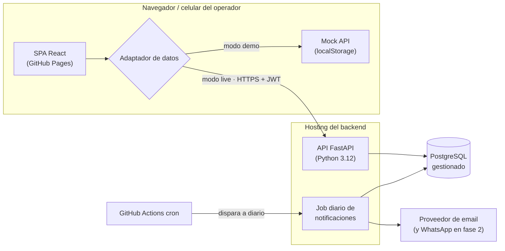
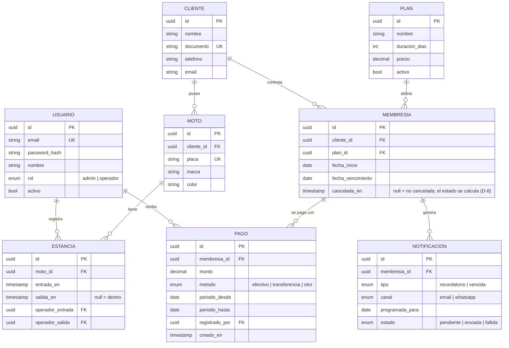
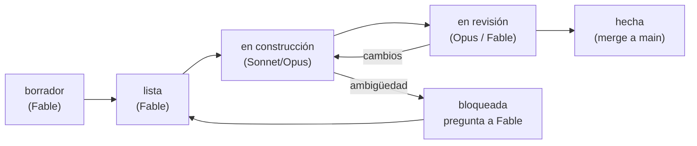
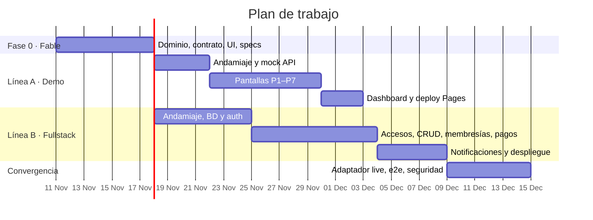

# Hoja de ruta y arquitectura · Parqueadero de motos

> Documento rector del proyecto. Define **qué** se construye, **cómo** se organiza el sistema y **quién** (qué agente) construye cada pieza.
> Estado: `borrador v0.1` · Última actualización: 2026-11-10

---

## 1. Visión

Una aplicación web para administrar un parqueadero de motos que permite:

1. **Gestionar clientes, motos y membresías** (planes mensuales, quincenales, etc.).
2. **Notificar fechas de pago** antes y después del vencimiento de cada membresía.
3. **Registrar entradas y salidas** de las motos en tiempo real.
4. **Almacenar todo de forma segura** en una base de datos SQL, con historial y auditoría.

Restricciones fijadas por el cliente:

| Restricción | Cómo se cumple |
|---|---|
| Accesible como **GitHub Pages** | El frontend es una SPA estática publicada en GitHub Pages. |
| Login con **email y contraseña** | Autenticación propia en el backend (hash Argon2id + JWT). |
| Debe ser una **webapp** | SPA responsive, instalable como PWA en el celular del operador. |
| Backend en **Python** | API REST con FastAPI. |
| Datos **seguros en SQL** | PostgreSQL gestionado, conexión TLS, migraciones versionadas, backups. |

### Dos líneas de trabajo en paralelo

| Línea | Objetivo | Resultado |
|---|---|---|
| **A · Demo** | Mostrar la app funcionando lo antes posible, sin backend. | El frontend real corriendo en GitHub Pages con una API simulada (datos en el navegador). |
| **B · Fullstack** | Construir el producto de verdad. | Backend Python + PostgreSQL desplegado, y el mismo frontend conectado a él. |

La clave para que ambas líneas avancen en paralelo sin duplicar trabajo: **el demo no es un prototipo desechable, es el frontend definitivo usando un adaptador de datos simulado.** Ambas líneas comparten un único contrato de API (`contracts/openapi.yaml`). Cuando el backend está listo, se cambia una variable de entorno y el demo pasa a ser la app real.

---

## 2. Arquitectura

### 2.1 Vista general



### 2.2 Stack propuesto

| Capa | Tecnología | Motivo |
|---|---|---|
| Frontend | React 18 + TypeScript + Vite | Build estático ideal para GitHub Pages; muy bien conocido por los agentes. |
| Estilos / UI | Tailwind CSS + componentes propios (`ui/`) | Sistema de diseño definido por Fable en tokens; fácil de implementar por partes. |
| Ruteo | React Router con `HashRouter` | GitHub Pages no soporta reescrituras de rutas; el hash evita los 404. |
| Datos en cliente | TanStack Query | Caché, reintentos y estados de carga uniformes. |
| Formularios | react-hook-form + zod | Validación declarativa que refleja los esquemas del contrato. |
| Backend | FastAPI + Pydantic v2 | Python, rápido, genera OpenAPI y valida entradas. |
| ORM / migraciones | SQLAlchemy 2.0 + Alembic | Consultas parametrizadas (sin inyección SQL) y esquema versionado. |
| Base de datos | PostgreSQL 16 (Neon, Supabase o Render) | SQL gestionado con TLS, backups y plan gratuito. |
| Auth | Argon2id (`argon2-cffi`) + JWT (`pyjwt`) | Estándar actual para contraseñas y sesiones sin estado. |
| Notificaciones | Email (Resend o SMTP); WhatsApp como fase 2 | Email es gratis y suficiente para el MVP. |
| Tareas programadas | GitHub Actions `schedule` → endpoint interno protegido | Funciona aunque el hosting gratuito “duerma” el servidor. |
| Hosting backend | Render o Railway (contenedor Docker) | Despliegue desde el repo, HTTPS incluido. |
| Pruebas | pytest + httpx (backend), Vitest + Testing Library (frontend), Playwright (e2e) | Cada spec define sus pruebas de aceptación. |
| CI/CD | GitHub Actions | Lint + pruebas en cada PR; deploy de Pages en `main`. |

> Las elecciones de hosting (Render vs Railway; Neon vs Supabase) quedan como **decisión abierta D-1** (ver sección 7). El código no depende de cuál se elija: solo de `DATABASE_URL`.

### 2.3 Estructura del repositorio (monorepo)

```
PROYECTO-PARQUEADERO/
├── README.md
├── CLAUDE.md                    # Reglas para los agentes constructores (fase 0)
├── docs/
│   ├── ROADMAP.md               # Este documento
│   ├── dominio.md               # Glosario y reglas de negocio (Fable)
│   └── ui/                      # Design system, wireframes, flujos (Fable)
├── contracts/
│   └── openapi.yaml             # Contrato único de la API (fuente de verdad)
├── specs/
│   ├── _PLANTILLA.md            # Plantilla de especificación
│   └── <ID>-<slug>.md           # Una spec por módulo (ver catálogo, sección 4)
├── frontend/
│   ├── src/
│   │   ├── app/                 # Ruteo, layout, proveedores
│   │   ├── ui/                  # Componentes del design system
│   │   ├── features/            # auth, clientes, membresias, accesos, pagos, dashboard
│   │   └── api/
│   │       ├── client.ts        # Interfaz común
│   │       ├── live/            # Implementación HTTP → backend
│   │       └── mock/            # Implementación simulada (demo)
│   └── vite.config.ts
├── backend/
│   ├── app/
│   │   ├── main.py
│   │   ├── core/                # config, seguridad, dependencias
│   │   ├── db/                  # sesión, modelos base
│   │   ├── modules/             # auth, clientes, motos, planes, membresias, accesos, pagos, notificaciones
│   │   │   └── <modulo>/        # models.py · schemas.py · service.py · router.py
│   │   └── jobs/                # tareas programadas
│   ├── alembic/
│   ├── tests/
│   └── Dockerfile
└── .github/workflows/           # ci.yml · pages.yml · notificaciones-cron.yml
```

Cada módulo del backend sigue la misma forma (`models`, `schemas`, `service`, `router`). Así un agente puede construir un módulo nuevo copiando la forma de otro, y las specs pueden referirse a archivos exactos.

### 2.4 Modelo de datos (esqueleto)



Además, una tabla `auditoria` (usuario, acción, entidad, id, datos, fecha) registra toda escritura.

**Reglas de negocio iniciales** (Fable las detalla en `docs/dominio.md`):

- Una moto solo puede tener **una estancia abierta** a la vez (índice único parcial `WHERE salida_en IS NULL`).
- Al registrar una entrada se muestra el estado de la membresía del cliente; si está vencida, se **avisa** pero no se bloquea (decisión del operador).
- Registrar un pago **extiende** `fecha_vencimiento` según el plan.
- El estado `por_vencer` aplica N días antes del vencimiento (configurable, por defecto 3).
- Los recordatorios se programan a **3 días, 1 día y el día** del vencimiento, y un aviso de mora al día siguiente.

### 2.5 API (esqueleto del contrato)

Todas las rutas bajo `/api/v1`. El detalle vive en `contracts/openapi.yaml`, que Fable escribe en la fase 0.

| Recurso | Endpoints principales |
|---|---|
| Auth | `POST /auth/login` · `POST /auth/refresh` · `POST /auth/logout` · `GET /auth/me` |
| Usuarios (admin) | `GET/POST /usuarios` · `PATCH /usuarios/{id}` |
| Clientes | `GET/POST /clientes` · `GET/PATCH /clientes/{id}` |
| Motos | `GET/POST /motos` · `GET /motos?placa=` · `PATCH /motos/{id}` |
| Planes | `GET/POST /planes` · `PATCH /planes/{id}` |
| Membresías | `GET/POST /membresias` · `GET /membresias?estado=por_vencer` · `PATCH /membresias/{id}` |
| Pagos | `GET/POST /pagos` · `GET /membresias/{id}/pagos` |
| Accesos | `POST /accesos/entrada` · `POST /accesos/salida` · `GET /accesos/dentro` · `GET /accesos/historial` |
| Dashboard | `GET /dashboard/resumen` |
| Interno | `POST /internal/jobs/notificaciones` (token de servicio, no JWT de usuario) |

### 2.6 Seguridad

| Riesgo | Medida |
|---|---|
| Contraseñas robadas | Hash Argon2id; nunca se guardan ni se registran en logs en claro. |
| Fuerza bruta en login | Límite de intentos por IP y por email (p. ej. 5/min) y bloqueo temporal. |
| Sesiones | JWT de acceso de 15 min en memoria + refresh token rotativo (guardado como hash en BD, revocable). |
| Acceso indebido | CORS limitado al dominio de GitHub Pages; roles `admin`/`operador` validados en cada endpoint. |
| Inyección SQL | Solo SQLAlchemy con parámetros; prohibido SQL concatenado. |
| Datos en tránsito / reposo | HTTPS obligatorio; PostgreSQL con TLS y cifrado en reposo del proveedor. |
| Secretos | Variables de entorno del hosting y GitHub Secrets; nunca en el repo. |
| Pérdida de datos | Backups automáticos diarios del proveedor + borrado lógico en entidades principales. |
| Trazabilidad | Tabla `auditoria` en toda escritura. |
| Demo público | El modo demo usa datos ficticios en el navegador del visitante; nunca toca la base real. |

> Nota: como GitHub Pages (`*.github.io`) y el backend viven en dominios distintos, las cookies de terceros no son confiables en navegadores modernos. Por eso el MVP usa tokens en cabecera `Authorization`. Si más adelante se usa un dominio propio para ambos (p. ej. `app.parqueadero.com` y `api.parqueadero.com`), se puede pasar el refresh token a cookie `HttpOnly`.

### 2.7 Pantallas (esqueleto de UI)

Fable entrega para cada una: wireframe, estados (carga, vacío, error), textos y criterios de aceptación.

| # | Pantalla | Rol | Propósito |
|---|---|---|---|
| P1 | Login | todos | Email + contraseña; “olvidé mi contraseña” en fase 2. |
| P2 | Dashboard | todos | Motos dentro ahora, membresías por vencer, pagos del día. |
| P3 | Registro de acceso | operador | Buscar por placa → **Entrada** / **Salida** en un toque. Pantalla principal en celular. |
| P4 | Clientes | todos | Lista, búsqueda, ficha con motos, membresía e historial. |
| P5 | Nuevo cliente / moto | todos | Alta rápida con validación. |
| P6 | Membresías | todos | Filtro por estado; renovar; cambiar plan. |
| P7 | Registrar pago | todos | Elegir membresía, monto, método; muestra nueva fecha de vencimiento. |
| P8 | Historial de accesos | admin | Filtros por fecha, placa, operador; exportar CSV. |
| P9 | Configuración | admin | Planes, usuarios, días de aviso, plantillas de mensaje. |

---

## 3. Flujo de trabajo con agentes

### 3.1 Roles

| Agente | Rol | Entrega |
|---|---|---|
| **Fable** | Arquitecto y diseñador. Decide, especifica y valida. No escribe código de producción. | `docs/dominio.md`, `docs/ui/*`, `contracts/openapi.yaml`, `specs/*.md`, revisión final contra criterios de aceptación. |
| **Opus** | Constructor de módulos críticos o complejos, y revisor técnico. | Esquema de BD y migraciones, autenticación y seguridad, lógica de membresías/pagos, notificaciones, integración demo→live, revisión de PRs de Sonnet. |
| **Sonnet** | Constructor de módulos bien acotados. | Pantallas y componentes de UI, CRUD estándar, mock API, pruebas, CI/CD, documentación de uso. |

Criterio de asignación: **Opus** cuando un error compromete datos, dinero o seguridad, o cuando la pieza cruza varios módulos. **Sonnet** cuando la spec define con precisión entradas, salidas y archivos, y el trabajo es repetible.

### 3.2 Ciclo de vida de una spec



1. **Fable** escribe `specs/<ID>-<slug>.md` usando `specs/_PLANTILLA.md` y la marca `lista` cuando sus dependencias están hechas.
2. Un **constructor** toma una sola spec, crea la rama `feat/<ID>-<slug>`, implementa **solo** los archivos listados en “Alcance”, y abre un PR con el ID de la spec en el título.
3. **Revisión**: Opus revisa los PRs de Sonnet; Fable revisa los de Opus contra los criterios de aceptación. CI en verde es obligatorio.
4. Merge a `main` → la spec pasa a `hecha` y se actualiza el catálogo (sección 4).

### 3.3 Reglas para los constructores

Estas reglas irán en `CLAUDE.md` para que los agentes las lean automáticamente:

- La spec y `contracts/openapi.yaml` son la **fuente de verdad**. Si algo no está especificado, **no se inventa**: se agrega en la sección “Preguntas abiertas” de la spec, se marca `bloqueada` y se detiene.
- No se modifica el contrato de API desde una spec de construcción. Los cambios de contrato los hace Fable en una spec propia.
- No se tocan archivos fuera del “Alcance” de la spec, salvo los listados como “puede tocar”.
- Cada criterio de aceptación debe tener al menos una prueba automatizada.
- Un PR = una spec. PRs pequeños y revisables.

### 3.4 Cómo invocar a cada agente

Ejemplos de instrucción para iniciar una sesión:

- **Fable**: “Lee `docs/ROADMAP.md`. Escribe la spec `B-04` usando `specs/_PLANTILLA.md`, con el contrato de `contracts/openapi.yaml`. Déjala en estado `lista`.”
- **Sonnet / Opus**: “Lee `CLAUDE.md` y `specs/B-04-accesos-backend.md`. Implementa solo esa spec en la rama `feat/B-04-accesos-backend`, con pruebas, y abre un PR.”

---

## 4. Catálogo de specs y asignación

Leyenda de estado: ⬜ por escribir · 📝 borrador · ✅ lista · 🔨 en construcción · 👀 en revisión · ✔️ hecha

### Fase 0 · Fundamentos (Fable) — bloquea todo lo demás

| ID | Entregable | Agente | Depende de | Estado |
|---|---|---|---|---|
| F-01 | `docs/dominio.md`: glosario, reglas de negocio, casos borde | Fable | — | ✔️ |
| F-02 | `contracts/openapi.yaml`: contrato completo v1 | Fable | F-01 | ✔️ |
| F-03 | `docs/ui/design-system.md`: tokens (color, tipografía, espaciado), componentes base | Fable | — | ✔️ |
| F-04 | `docs/ui/pantallas.md`: wireframes y flujos P1–P9 | Fable | F-01, F-03 | ✔️ |
| F-05 | `CLAUDE.md`: reglas para constructores | Fable | — | ✔️ |
| F-06 | Specs de las fases A, B y C | Fable | F-01…F-04 | ✔️ |

### Línea A · Demo (frontend + mock)

| ID | Módulo | Agente | Depende de | Estado |
|---|---|---|---|---|
| A-01 | Andamiaje frontend: Vite, TS, Tailwind, HashRouter, layout, lint | Sonnet | F-03, F-05 | ✅ |
| A-02 | Capa `api/`: interfaz común + adaptador **mock** con datos semilla en localStorage | Sonnet | F-02, A-01 | 👀 |
| A-03 | Componentes base del design system (`ui/`) | Sonnet | F-03, A-01 | 👀 |
| A-04 | P1 Login + guardas de ruta + manejo de sesión | Sonnet | A-02, A-03 | 👀 |
| A-05 | P3 Registro de acceso (entrada/salida por placa) | Sonnet | A-04 | 👀 |
| A-06 | P4/P5 Clientes y motos | Sonnet | A-04 | 👀 |
| A-07 | P6/P7 Membresías y pagos | Sonnet | A-04, A-06 | ✅ |
| A-08 | P2 Dashboard | Sonnet | A-05, A-06, A-07 | ✅ |
| A-09 | Deploy a GitHub Pages (workflow) + banner “Modo demo” | Sonnet | A-01 | 👀 |
| A-10 | Revisión de UX y accesibilidad del demo completo | Fable | A-08 | ⬜ |

**Hito A — Demo publicado:** cualquier persona entra a la URL de GitHub Pages con `demo@parqueadero.app / demo1234` y recorre el flujo completo con datos ficticios.

### Línea B · Fullstack (backend + integración)

| ID | Módulo | Agente | Depende de | Estado |
|---|---|---|---|---|
| B-01 | Andamiaje backend: FastAPI, config, Docker, pytest, CI | Sonnet | F-05 | ✔️ |
| B-02 | Esquema de BD completo + migraciones Alembic + semilla | **Opus** | F-01, B-01 | ✔️ |
| B-03 | Autenticación: login, refresh rotativo, roles, rate limit, auditoría | **Opus** | B-02 | ✔️ |
| B-04 | Accesos: entrada/salida, “dentro ahora”, historial | Sonnet | B-03 | 👀 |
| B-05 | Clientes, motos y planes (CRUD) | Sonnet | B-03, B-04 | 👀 |
| B-06 | Membresías y pagos: estados, extensión de vencimiento, reglas | **Opus** | B-05 | 👀 |
| B-07 | Notificaciones: programación, envío por email, job + cron de Actions | **Opus** | B-06 | ✅ |
| B-08 | Dashboard y reportes (resumen, export CSV) | Sonnet | B-04, B-06 | ✅ |
| B-09 | Despliegue: hosting backend + PostgreSQL gestionado + secretos | **Opus** | B-03 | 👀 |
| B-10 | Usuarios y configuración (P9) — backend y pantalla | Sonnet | B-03, B-07, A-04 | ✅ |

### Convergencia (C)

| ID | Módulo | Agente | Depende de | Estado |
|---|---|---|---|---|
| C-01 | Adaptador **live** del frontend + `VITE_API_MODE` + manejo de tokens | **Opus** | A-02, A-04, B-03 | ✅ |
| C-02 | Pruebas e2e (Playwright) contra backend real en staging | Sonnet | C-01, B-09 | ✅ |
| C-03 | Auditoría de seguridad final | **Opus** | C-01 | ✅ |
| C-04 | Aceptación contra la visión y salida a producción | Fable | C-02, C-03 | ⬜ |

---

## 5. Cronograma orientativo

Las dos líneas arrancan juntas cuando termina la fase 0. Las semanas son orientativas y dependen del ritmo de revisión.



| Hito | Contenido | Semana aprox. |
|---|---|---|
| H0 | Fase 0 aprobada: contrato y specs listas | 1 |
| H1 | **Demo publicado** en GitHub Pages | 3–4 |
| H2 | Backend en staging con auth, accesos, membresías y pagos | 4–5 |
| H3 | Notificaciones funcionando | 5–6 |
| H4 | **Producción**: frontend conectado al backend real | 6–7 |

### Fase 2 (después del MVP)

- Notificaciones por WhatsApp (API de WhatsApp Business o Twilio).
- Recuperación de contraseña por email.
- Tarifa por horas para visitantes sin membresía.
- Lectura de placa con la cámara del celular (OCR) en P3.
- Portal para que el cliente vea su membresía.
- Reportes financieros mensuales.

---

## 6. Definición de “hecho”

Un módulo está hecho cuando:

- [ ] Cumple todos los criterios de aceptación de su spec, cada uno con prueba automatizada.
- [ ] CI en verde (lint, tipos, pruebas).
- [ ] No hay secretos, datos reales ni `TODO` sin issue en el código.
- [ ] Revisado y aprobado según la sección 3.2.
- [ ] El catálogo (sección 4) está actualizado.

---

## 7. Decisiones abiertas

Fable debe cerrarlas en la fase 0, con confirmación del dueño del proyecto.

> **Estado (2026-11-10):** se adoptaron las propuestas por defecto de D-1 a D-7 y se añadieron D-8 a D-12. Todas están registradas en [`docs/dominio.md`](dominio.md#1-decisiones-cerradas) y fueron **confirmadas por el dueño del proyecto** ese mismo día.

| ID | Pregunta | Propuesta por defecto |
|---|---|---|
| D-1 | ¿Dónde se aloja el backend y la base de datos? | Render (backend) + Neon (PostgreSQL), ambos con plan gratuito para empezar. |
| D-2 | ¿Quién inicia sesión: solo personal del parqueadero, o también clientes? | Solo personal (admin y operadores) en el MVP. |
| D-3 | ¿Por qué canal se notifican los pagos? | Email en el MVP; WhatsApp en fase 2. |
| D-4 | ¿Se atiende a motos sin membresía (cobro por horas)? | No en el MVP; queda en fase 2. |
| D-5 | ¿Se bloquea la entrada si la membresía está vencida? | No: se avisa y el operador decide. |
| D-6 | ¿Moneda y formato? | COP, sin decimales; zona horaria `America/Bogota`. |
| D-7 | ¿Una membresía cubre una moto o todas las del cliente? | Una membresía por cliente cubre todas sus motos registradas. |
