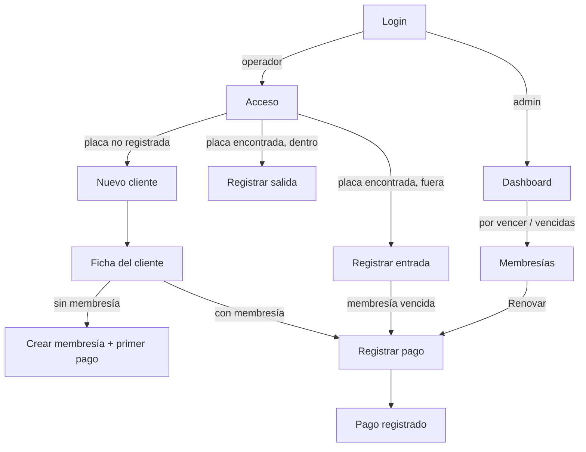

# Pantallas y flujos · Parqueadero de motos

> Entregable **F-04**. Define cada pantalla: estructura, estados, textos exactos y comportamiento. Los componentes son los de `docs/ui/design-system.md`; los datos, los de `contracts/openapi.yaml`.
> Estado: `v1.0` · Última actualización: 2026-11-10

Los textos entre comillas se usan **tal cual**. Los esquemas muestran el móvil (360 px); la sección “Escritorio” de cada pantalla indica qué cambia desde `md`.

---

## 0. Reglas comunes

### 0.1 Navegación

| Destino | Ruta | Icono | Rol | Móvil |
|---|---|---|---|---|
| Inicio | `/` | `LayoutDashboard` | todos | barra inferior |
| Clientes | `/clientes` | `Users` | todos | barra inferior |
| Acceso | `/acceso` | `ScanLine` | todos | barra inferior, botón central destacado |
| Membresías | `/membresias` | `IdCard` | todos | barra inferior |
| Pagos | `/pagos` | `Banknote` | todos | hoja “Más” |
| Historial | `/historial` | `History` | admin | hoja “Más” |
| Configuración | `/configuracion` | `Settings` | admin | hoja “Más” |
| Cerrar sesión | — | `LogOut` | todos | hoja “Más” |

Tras iniciar sesión, el **operador** llega a `/acceso` y el **admin** a `/`.

### 0.2 Estados obligatorios de toda vista con datos

| Estado | Qué se muestra |
|---|---|
| Carga inicial | `Esqueleto` con la forma del contenido. Nunca un spinner a pantalla completa. |
| Recarga con datos previos | Los datos anteriores siguen visibles; sin parpadeo. |
| Vacío | `EstadoVacio` con el texto indicado en cada pantalla. |
| Error de carga | `EstadoError`: “No pudimos cargar esta información.” y botón “Reintentar”. |
| Sin conexión (solo modo live) | `Aviso` de tono `aviso`: “Sin conexión. Revisa tu internet e inténtalo de nuevo.” |

### 0.3 Errores de acciones

- Un error con `codigo: validacion` marca cada campo de `detalles` con su mensaje y enfoca el primero.
- Cualquier otro error de una acción muestra un `Toast` de tono `peligro` con el `mensaje` que devuelve la API.
- Si la API responde 401 y el refresh falla: se limpia la sesión, se va a `/login` y se muestra “Tu sesión venció. Inicia sesión otra vez.” Tras entrar, se vuelve a la ruta donde estaba.
- Si un usuario abre una ruta para la que no tiene rol: pantalla “No tienes permiso para ver esta página.” con botón “Ir al inicio”.

### 0.4 Formularios

- El botón de enviar muestra `cargando` y se deshabilita mientras la petición está en curso (evita dobles envíos).
- La validación en cliente replica los límites del contrato (zod) y se muestra al salir del campo y al enviar.
- Si hay cambios sin guardar y el usuario intenta salir: `DialogoConfirmar` “¿Descartar los cambios?” · “Descartar” / “Seguir editando”.

### 0.5 Banner de demo

Solo con `VITE_API_MODE=mock`, visible en todas las pantallas incluida la de login:

> “Modo demo: los datos son ficticios y se guardan solo en este navegador.” · botón “Reiniciar datos”

“Reiniciar datos” pide confirmación (“Se borrarán los cambios que hayas hecho en el demo.” · “Reiniciar” / “Cancelar”), vuelve a sembrar y recarga la vista.

---

## P1 · Login (`/login`)

```
┌──────────────────────────────┐
│ [BannerDemo, solo en demo]   │
│                              │
│        ▣ ABC12D ▣            │  ← Placa decorativa como logotipo
│        Parqueadero           │
│                              │
│  Email                       │
│  [ nombre@correo.com      ]  │
│  Contraseña                  │
│  [ ••••••••            👁 ]  │
│                              │
│  [      Iniciar sesión     ] │  ← Boton primario, lg, ancho completo
│                              │
│  ┌ Aviso info, solo en demo ┐│
│  │ Usuario de prueba:       ││
│  │ demo@parqueadero.app     ││
│  │ Contraseña: demo1234     ││
│  │ [Usar estos datos]       ││
│  └──────────────────────────┘│
└──────────────────────────────┘
```

- **Campos:** “Email” (`type=email`, `autocomplete=username`), “Contraseña” (`autocomplete=current-password`, con botón mostrar/ocultar: “Mostrar contraseña” / “Ocultar contraseña”).
- **Validación:** “Escribe tu email.” · “Ese email no parece válido.” · “Escribe tu contraseña.”
- **Errores de la API**, en un `Aviso` de tono `peligro` sobre el botón:
  - `credenciales_invalidas` → “Email o contraseña incorrectos.”
  - `demasiados_intentos` → “Demasiados intentos. Espera unos minutos e inténtalo de nuevo.”
  - otro → “No pudimos iniciar sesión. Inténtalo de nuevo.”
- Tras un error, la contraseña se vacía y recibe el foco; el email se conserva.
- “Usar estos datos” rellena ambos campos (no envía).
- Si ya hay sesión válida, `/login` redirige al inicio.
- **Escritorio:** tarjeta centrada de 400 px sobre fondo `asfalto-50`.

---

## P2 · Dashboard (`/`)

```
┌──────────────────────────────┐
│ Inicio                   (U) │
│ Hola, Ana · lun 10 nov       │
│ ┌────────────┐┌────────────┐ │
│ │ Dentro     ││ Por vencer │ │
│ │ 12 / 40    ││ 3          │ │
│ └────────────┘└────────────┘ │
│ ┌────────────┐┌────────────┐ │
│ │ Vencidas   ││ Pagos hoy  │ │
│ │ 2          ││ $180.000   │ │
│ │            ││ 3 pagos    │ │
│ └────────────┘└────────────┘ │
│ ⚠ 1 moto lleva más de 24 h   │
│   dentro.  [Ver]             │
│                              │
│ Próximos vencimientos   Ver ▸│
│ ┌──────────────────────────┐ │
│ │ Carlos Pérez   [Por vencer]││
│ │ ABC12D · vence mañana  ▸ │ │
│ ├──────────────────────────┤ │
│ │ …hasta 5                 │ │
│ └──────────────────────────┘ │
│ Movimiento de hoy            │
│ Entradas 18 · Salidas 9      │
└──────────────────────────────┘
```

- **Datos:** `GET /dashboard/resumen`. Se refresca al volver a la pestaña y cada 60 segundos.
- **Indicadores** (`Indicador`, cada uno es un enlace):

  | Etiqueta | Valor | Tono | Lleva a |
  |---|---|---|---|
  | “Dentro ahora” | `motos_dentro / capacidad` (sin `/ capacidad` si es nula) | — | `/acceso` (pestaña Dentro) |
  | “Por vencer” | `membresias.por_vencer` | `aviso` si > 0 | `/membresias?estado=por_vencer` |
  | “Vencidas” | `membresias.vencidas` | `peligro` si > 0 | `/membresias?estado=vencida` |
  | “Pagos de hoy” | `pagos_hoy.total` con detalle “N pagos” | — | `/pagos` filtrado a hoy |

- **Aviso de estancias largas:** solo si `estancias_largas > 0`. “1 moto lleva más de 24 h dentro.” / “N motos llevan más de 24 h dentro.” · “Ver” lleva a `/acceso` (pestaña Dentro).
- **Próximos vencimientos:** lista de `proximos_vencimientos`. Cada elemento: nombre, `InsigniaEstado`, primera placa (más “+1” si hay otras) y `formatoDiasRestantes`. Al tocar: ficha del cliente. “Ver todas” lleva a `/membresias`. Vacío: “Ninguna membresía vence en los próximos días.”
- **Movimiento de hoy:** “Entradas N · Salidas N”.
- **Escritorio:** los cuatro indicadores en una fila; debajo, dos columnas (vencimientos y movimiento).

---

## P3 · Registro de acceso (`/acceso`)

La pantalla más usada. Debe poder completarse una entrada en **dos toques** después de escribir la placa.

Dos pestañas: **“Registrar”** (por defecto) y **“Dentro (N)”**.

### Pestaña Registrar

```
┌──────────────────────────────┐
│ Acceso                   (U) │
│ [ Registrar ] [ Dentro (12) ]│
│                              │
│  Placa                       │
│  ┌────────────────────────┐  │
│  │        ABC12D          │  │  ← EntradaPlaca, foco automático
│  └────────────────────────┘  │
│  [        Buscar          ]  │
│                              │
│ ── resultado ─────────────── │
│  ▣ ABC12D ▣   Honda · Negra  │
│  Carlos Pérez                │
│  [Por vencer · vence mañana] │
│  ⚠ La membresía vence pronto.│
│                              │
│  [   ⮕  Registrar entrada  ] │  ← Boton exito, xl
│  Ver cliente                 │
└──────────────────────────────┘
```

**Flujo**

1. Al abrir, el foco está en la placa. Enter o “Buscar” llama a `GET /accesos/consulta`. El botón se habilita con 4 caracteres o más.
2. **Resultado encontrado.** Tarjeta con `Placa` (lg), marca y color, nombre del cliente, `InsigniaEstado` con días restantes y, según corresponda:

   | Situación | Aviso | Botón principal |
   |---|---|---|
   | Fuera, sin advertencias | — | “Registrar entrada” (`exito`, xl, icono `LogIn`) |
   | Fuera, `membresia_por_vencer` | tono `aviso`: “La membresía vence pronto.” | “Registrar entrada” |
   | Fuera, `membresia_vencida` | tono `peligro`: “Membresía vencida. Puedes registrar la entrada y cobrar la renovación.” + enlace “Registrar pago” | “Registrar entrada de todos modos” |
   | Fuera, `sin_membresia` | tono `peligro`: “Este cliente no tiene membresía.” + enlace “Crear membresía” | “Registrar entrada de todos modos” |
   | Dentro | tono `info`: “Dentro desde las 8:15 a. m. (2 h 15 min).” | “Registrar salida” (`secundario`, xl, icono `LogOut`) |

3. **Confirmación.** Al registrar: `Toast` de tono `exito` “Entrada registrada · ABC12D” o “Salida registrada · ABC12D · 2 h 15 min”, se limpia el campo, se borra el resultado y el foco vuelve a la placa. No hay diálogo de confirmación previo.
4. **Placa no registrada** (`moto_no_registrada`): `EstadoVacio` “No hay ninguna moto con la placa ABC12D.” · botón “Registrar cliente nuevo” que lleva a `/clientes/nuevo?placa=ABC12D`.
5. **Conflictos** (`moto_ya_dentro`, `moto_no_esta_dentro`, por ejemplo si otro operador se adelantó): `Toast` con el mensaje de la API y se repite la consulta para mostrar el estado real.
6. Placa con formato inválido: “La placa debe tener entre 4 y 7 letras o números.”

### Pestaña Dentro

- `GET /accesos/dentro`. Encabezado: “12 motos dentro” o “12 de 40 motos dentro”.
- `Buscador` “Filtrar por placa”.
- Lista: `Placa`, nombre del cliente, “Desde las 8:15 a. m. · 2 h 15 min”. Las de más de 24 horas llevan `Insignia` de tono `aviso` “Más de 24 h”.
- Cada elemento tiene el botón “Salida”, que pide confirmación: “¿Registrar la salida de ABC12D?” · “Registrar salida” / “Cancelar”.
- Vacío: “No hay motos dentro en este momento.” Vacío con filtro: “Ninguna moto dentro coincide con esa placa.”

**Escritorio:** las dos pestañas se muestran como dos columnas a la vez (registrar a la izquierda, dentro a la derecha).

---

## P4 · Clientes

### Lista (`/clientes`)

```
┌──────────────────────────────┐
│ Clientes            [+ Nuevo]│
│ [🔍 Nombre, documento o placa]│
│ (Todos)(Activa)(Por vencer)  │
│ (Vencida)(Sin membresía)     │
│ ┌──────────────────────────┐ │
│ │ Carlos Pérez     [Activa]│ │
│ │ ▣ABC12D▣ ▣XYZ98A▣      ▸ │ │
│ ├──────────────────────────┤ │
│ │ …                        │ │
│ └──────────────────────────┘ │
│  ‹ Anterior · 1 de 3 · Sig › │
└──────────────────────────────┘
```

- `GET /clientes` con `q`, `estado_membresia` y paginación. Los filtros y la página viven en la URL (`?q=&estado=&pagina=`).
- Filtro de estado con `GrupoOpciones`: “Todos”, “Activa”, “Por vencer”, “Vencida”, “Sin membresía”.
- Elemento: nombre, `InsigniaEstado`, placas (`Placa` sm; máximo 2 y “+N”).
- Vacío sin filtros: “Aún no hay clientes.” · “Registrar el primero”. Vacío con filtros: “Ningún cliente coincide con la búsqueda.” · “Limpiar filtros”.
- Admin: interruptor “Mostrar inactivos” (`activo=false`); los inactivos llevan `Insignia` “Inactivo”.
- **Escritorio:** `Tabla` con columnas Nombre, Documento, Teléfono, Placas, Membresía, Vence.

### Ficha (`/clientes/:id`)

```
┌──────────────────────────────┐
│ ‹ Carlos Pérez       [Editar]│
│ CC 900000123 · 300 000 0001  │
│ carlos@example.com           │
│                              │
│ Membresía                    │
│ ┌──────────────────────────┐ │
│ │ Mensual · $60.000        │ │
│ │ [Por vencer·vence mañana]│ │
│ │ Vence el 11 nov 2026     │ │
│ │ [Registrar pago]         │ │
│ │ Cambiar plan · Cancelar  │ │
│ └──────────────────────────┘ │
│ Motos                [+ Moto]│
│ ▣ABC12D▣ Honda · Negra  [Dentro] ✎│
│ ▣XYZ98A▣ Yamaha · Azul         ✎│
│                              │
│ [Pagos] [Accesos]            │
│ 10 oct · $60.000 · Efectivo  │
│ …                            │
└──────────────────────────────┘
```

- **Cabecera:** nombre, documento, teléfono (enlace `tel:`), email. Sin email: `Aviso` de tono `aviso` “Sin email: no recibirá avisos de vencimiento.”
- **Membresía:**
  - Con membresía: plan y precio, `InsigniaEstado`, “Vence el {fecha}”, botón primario “Registrar pago” (`/pagos/nuevo?membresia=<id>`), y enlaces “Cambiar plan” y, solo admin, “Cancelar membresía”.
  - Sin membresía: “Este cliente no tiene membresía.” · botón primario “Crear membresía” (abre la hoja de P6).
- **Motos:** `Placa`, marca y color, `Insignia` “Dentro” si aplica, botón editar. “+ Moto” abre una `Hoja` con Placa, Marca y Color.
- **Pestañas:** “Pagos” (`GET /pagos?cliente_id=`, sin filtro de fechas; los anulados tachados con `Insignia` “Anulado”) y “Accesos” (solo admin, `GET /accesos/historial?cliente_id=`).
- **Editar:** `Hoja` con los campos de P5. Solo admin: “Desactivar cliente” con confirmación “El cliente y sus motos dejarán de aparecer en las búsquedas. Su historial se conserva.”
- **Cambiar plan:** `Hoja` con `Selector` de planes activos y la nota “El cambio aplica desde el próximo pago. La fecha de vencimiento actual no cambia.” · “Cambiar plan”.
- **Cancelar membresía** (admin): `DialogoConfirmar` con `pedirMotivo`: “¿Cancelar la membresía de Carlos Pérez?” · “Esta acción es definitiva. Para volver, habrá que crear una membresía nueva.” · botón `peligro` “Cancelar membresía” / “Volver”.

---

## P5 · Nuevo cliente (`/clientes/nuevo`)

```
┌──────────────────────────────┐
│ ‹ Nuevo cliente              │
│ Nombre completo *            │
│ [                          ] │
│ Documento *                  │
│ [                          ] │
│ Teléfono *                   │
│ [                          ] │
│ Email (opcional)             │
│ [                          ] │
│ Para enviarle avisos de pago │
│ Notas (opcional)             │
│ [                          ] │
│                              │
│ Moto                         │
│ Placa *   [   ABC12D     ]   │
│ Marca     [              ]   │
│ Color     [              ]   │
│ + Agregar otra moto          │
│                              │
│ [     Guardar cliente      ] │
└──────────────────────────────┘
```

- `POST /clientes` con `motos` (una fila por defecto; hasta 5; se puede quitar para crear un cliente sin moto).
- Si llega `?placa=`, la primera placa viene rellenada.
- **Validación:** “Escribe el nombre.” · “El documento debe tener entre 5 y 20 letras o números.” · “El teléfono debe tener entre 7 y 15 dígitos.” · “Ese email no parece válido.” · “La placa debe tener entre 4 y 7 letras o números.”
- **Conflictos:** `documento_duplicado` → bajo Documento: “Ya existe un cliente con ese documento.” · `placa_duplicada` → bajo la placa: “Esa placa ya está registrada.”
- **Éxito:** `Toast` “Cliente registrado.” y se abre su ficha, con la hoja “Crear membresía” ya abierta.

---

## P6 · Membresías (`/membresias`)

```
┌──────────────────────────────┐
│ Membresías                   │
│ [🔍 Cliente o placa        ] │
│ (Todas)(Por vencer)(Vencidas)│
│ (Activas)(Canceladas)        │
│ ┌──────────────────────────┐ │
│ │ Carlos Pérez  [Por vencer]│ │
│ │ Mensual · vence mañana   │ │
│ │ ▣ABC12D▣       [Renovar] │ │
│ ├──────────────────────────┤ │
│ │ …                        │ │
│ └──────────────────────────┘ │
└──────────────────────────────┘
```

- `GET /membresias` con `estado`, `q` y paginación; filtros en la URL. Orden: vencimiento ascendente (lo más urgente arriba).
- Elemento: nombre, `InsigniaEstado`, plan, `formatoDiasRestantes`, placas, botón “Renovar” (`/pagos/nuevo?membresia=<id>`; oculto en canceladas). Tocar el resto abre la ficha del cliente.
- Vacío: “No hay membresías con este filtro.”
- **Escritorio:** `Tabla` con Cliente, Plan, Inicio, Vence, Estado, Acciones.

### Hoja “Crear membresía”

Se abre desde la ficha del cliente.

```
 Crear membresía · Carlos Pérez
 Plan *            [ Mensual · 30 días · $60.000 ▾ ]
 Fecha de inicio * [ 10 nov 2026 ]
 Monto *           [ $ 60.000 ]
 Método de pago *  (Efectivo)(Transferencia)(Otro)
 Nota              [                      ]
 ───────────────────────────────
 Cubre del 10 nov al 9 dic 2026
 [   Crear y registrar pago   ]
```

- `POST /membresias`. Plan: solo planes activos. Fecha de inicio: hoy por defecto.
- Al elegir plan, Monto se rellena con el precio. Si el monto se cambia, Nota pasa a ser obligatoria: “Explica por qué el monto es distinto al del plan.”
- La línea “Cubre del … al …” se calcula en vivo: inicio + duración − 1.
- **Errores:** `membresia_existente` → “Este cliente ya tiene una membresía.” · `plan_inactivo` → “Ese plan ya no está disponible.”
- **Éxito:** `Toast` “Membresía creada. Vence el 9 dic 2026.”

---

## P7 · Pagos

### Registrar pago (`/pagos/nuevo`)

```
┌──────────────────────────────┐
│ ‹ Registrar pago             │
│ Cliente                      │
│ ┌──────────────────────────┐ │
│ │ Carlos Pérez  [Por vencer]│ │
│ │ Mensual · vence mañana   │ │
│ │ Cambiar                  │ │
│ └──────────────────────────┘ │
│ Periodos                     │
│  [ − ]   1   [ + ]           │
│ Monto *                      │
│ [ $ 60.000                 ] │
│ Método de pago *             │
│ (Efectivo)(Transferencia)(Otro)│
│ Nota                         │
│ [                          ] │
│ ┌ Resumen ─────────────────┐ │
│ │ Cubre: 12 nov – 11 dic   │ │
│ │ Vencimiento actual: 11 nov│ │
│ │ Nuevo vencimiento: 11 dic│ │
│ └──────────────────────────┘ │
│ [   Registrar $60.000      ] │
└──────────────────────────────┘
```

- **Selección de membresía:** si llega `?membresia=<id>`, viene elegida. Si no, primero se muestra un `Buscador` “Busca por nombre, documento o placa” sobre `GET /membresias?q=` (sin canceladas).
- **Resumen:** `POST /pagos/previsualizar` cada vez que cambian la membresía o los periodos. Mientras carga, `Esqueleto`.
- **Periodos:** de 1 a 12. Al cambiarlos, Monto se actualiza con `monto_sugerido` salvo que el usuario ya lo haya editado a mano.
- **Monto distinto del sugerido:** Nota pasa a ser obligatoria, con la ayuda “Explica por qué el monto es distinto al sugerido ($60.000).”
- **Método:** `GrupoOpciones`; por defecto “Efectivo”.
- **Membresía vencida:** `Aviso` de tono `info` “La membresía está vencida: el nuevo periodo empieza hoy.”
- **Botón:** “Registrar {monto}”.
- **Errores:** `plan_inactivo` → `Aviso` “El plan de esta membresía ya no está disponible. Cambia el plan antes de registrar el pago.” con enlace a la ficha. `membresia_cancelada` → “Esta membresía está cancelada.”
- **Éxito:** pantalla de confirmación:

  ```
        ✓
   Pago registrado
   $60.000 · Efectivo
   Carlos Pérez
   Vence el 11 dic 2026

   [ Registrar otro pago ]   Ver cliente
  ```

### Lista de pagos (`/pagos`)

- `GET /pagos` con `desde`, `hasta`, `metodo` y paginación. Por defecto: hoy.
- Filtros rápidos: “Hoy”, “Últimos 7 días”, “Este mes”, “Personalizado” (dos fechas). `Selector` de método: “Todos los métodos”, “Efectivo”, “Transferencia”, “Otro”.
- Encabezado: “{total} pagos”. Elemento: fecha y hora, cliente, monto, método, “Registró: {nombre}”. Anulados: monto tachado e `Insignia` “Anulado”.
- Botón “Registrar pago” en la cabecera.
- **Anular** (solo admin, desde el detalle de un pago, que se abre en una `Hoja`): `DialogoConfirmar` con `pedirMotivo`: “¿Anular este pago de $60.000?” · “La fecha de vencimiento volverá al 11 nov 2026.” · botón `peligro` “Anular pago”. `pago_no_anulable` → “Solo se puede anular el último pago de una membresía.”
- Vacío: “No hay pagos en este periodo.”

---

## P8 · Historial de accesos (`/historial`) · admin

```
┌──────────────────────────────┐
│ Historial        [Exportar]  │
│ (Hoy)(7 días)(Este mes)(…)   │
│ [🔍 Placa ] [Operador ▾]     │
│ 128 registros                │
│ ┌──────────────────────────┐ │
│ │ ▣ABC12D▣  Carlos Pérez   │ │
│ │ 10 nov 8:15 a. m. → 10:30│ │
│ │ 2 h 15 min · Ana / Luis  │ │
│ ├──────────────────────────┤ │
│ │ ▣XYZ98A▣  …   [Dentro]   │ │
│ └──────────────────────────┘ │
│  ‹ Anterior · 1 de 7 · Sig › │
└──────────────────────────────┘
```

- `GET /accesos/historial` con `desde`, `hasta`, `placa`, `operador_id` y paginación (20). Por defecto: hoy. Filtros en la URL.
- El `Selector` de operador usa `GET /usuarios` (“Todos los operadores”).
- Elemento: `Placa`, cliente, entrada → salida (o `Insignia` “Dentro”), duración, operadores de entrada y salida.
- **Exportar:** “Exportar CSV” llama a `GET /accesos/historial/export` con los filtros vigentes y descarga el archivo. Si el rango supera 366 días, el botón se deshabilita con la ayuda “Elige un rango de máximo un año para exportar.” Mientras genera: `cargando`. Éxito: `Toast` “Archivo descargado.”
- Vacío: “No hay accesos en este periodo.”
- **Escritorio:** `Tabla` con Placa, Cliente, Entrada, Salida, Duración, Registró entrada, Registró salida.

---

## P9 · Configuración (`/configuracion`) · admin

Cuatro secciones en pestañas (móvil: lista que abre cada sección).

### General

- “Nombre del parqueadero” · “Capacidad (motos)”, con la ayuda “Opcional. Solo es informativa: no bloquea entradas.”
- “Guardar cambios” → `PATCH /configuracion` → `Toast` “Configuración guardada.”

### Planes

- Lista de `GET /planes`: nombre, “30 días”, precio, `Insignia` “Inactivo” si aplica. Botón “Nuevo plan”.
- Hoja de plan: “Nombre”, “Duración (días)”, “Precio”. `nombre_duplicado` → “Ya existe un plan con ese nombre.”
- Desactivar: confirmación “Las membresías que ya tienen este plan seguirán vigentes, pero no se podrá usar para pagos nuevos.” · “Desactivar plan”. Los inactivos tienen “Reactivar”.

### Usuarios

- Lista de `GET /usuarios`: nombre, email, `Insignia` de rol (“Administrador” / “Operador”), “Inactivo” si aplica. Botón “Nuevo usuario”.
- Hoja de usuario: “Nombre”, “Email”, “Rol” (`GrupoOpciones`), “Contraseña” (al crear; al editar se titula “Nueva contraseña (opcional)” con la ayuda “Déjala vacía para no cambiarla.”). Mínimo 8 caracteres: “La contraseña debe tener al menos 8 caracteres.”
- Errores: `email_duplicado` → “Ya existe un usuario con ese email.” · `ultimo_admin` → “Debe quedar al menos un administrador activo.” · `auto_desactivacion` → “No puedes desactivar tu propio usuario.”
- Desactivar: confirmación “{nombre} no podrá iniciar sesión.”

### Avisos de pago

- “Marcar como ‘por vencer’ cuando falten” [3] “días”.
- “Enviar recordatorio” con casillas: “3 días antes”, “1 día antes”, “El día del vencimiento” (corresponden a `dias_recordatorio`). Nota fija: “Además, se envía un aviso el día siguiente al vencimiento.”
- Plantillas “Recordatorio” y “Membresía vencida”: “Asunto” y “Mensaje”, con la ayuda “Puedes usar: {nombre}, {plan}, {fecha_vencimiento}, {precio}, {parqueadero}.” y una **vista previa** en vivo con datos de ejemplo (Carlos Pérez, Mensual, 11 nov 2026, $60.000).
- Enlace “Ver avisos enviados”: lista de `GET /notificaciones` con cliente, tipo, fecha y estado (“Pendiente”, “Enviado”, “Falló”, “Cancelado”).
- En modo demo, `Aviso` de tono `info`: “En el demo no se envían correos.”

### Mi cuenta (todos los roles, en el menú de usuario)

- Hoja “Cambiar contraseña”: “Contraseña actual”, “Contraseña nueva”, “Repite la contraseña nueva”. “Las contraseñas no coinciden.” · `password_incorrecta` → “La contraseña actual no es correcta.” · Éxito: se cierra la sesión y se muestra en el login “Contraseña cambiada. Inicia sesión con la nueva.”

---

## 10. Flujos principales



| Flujo | Pasos | Objetivo de toques |
|---|---|---|
| Entrada de un cliente al día | Placa → Buscar → Registrar entrada | 2 tras escribir la placa |
| Salida | Placa → Buscar → Registrar salida | 2 tras escribir la placa |
| Renovación | Membresías → Renovar → Registrar | 3 |
| Cliente nuevo que entra hoy | Placa → Registrar cliente nuevo → Guardar → Crear y registrar pago → Acceso → Entrada | un solo recorrido, sin volver a escribir la placa en el formulario |
